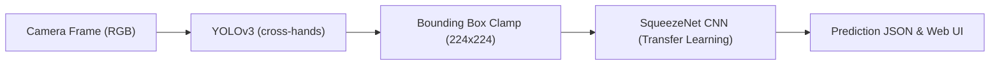
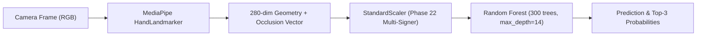

# Production Deployment & Operations Guide

**Application:** Indian Sign Language (ISL) Real-Time AI Translator  
**Status:** **Local Deployment-Ready**  
**Repository:** `/Users/pavanaksshay/pavan_sign_language`  
**Target Environment:** Python 3.10 – 3.12, macOS (Apple Silicon / Intel) or Linux (x86_64 / arm64)  
**Supported Inferences:** Real-Time Fingerspelling (26 Alphabet Classes A–Z) and Word Recognition (50 Vocabulary Classes)  

---

## 1. Quickstart & Production Startup

### 1.1 Prerequisites
- **Python:** 3.10, 3.11, or 3.12 (Virtual Environment recommended)
- **Camera:** Standard 720p or 1080p RGB webcam (or synthetic video feed)
- **Memory:** Minimum 4 GB RAM (8 GB recommended for simultaneous YOLO Darknet + MediaPipe execution)

### 1.2 Installation
```bash
# Clone the repository
git clone https://github.com/PavanAksshay/pavan_sign_language.git
cd pavan_sign_language

# Activate virtual environment
source /Users/pavanaksshay/venv/bin/activate
# Or create a fresh virtual environment:
# python3 -m venv venv && source venv/bin/activate

# Install required dependencies
pip install -r requirements.txt
```

### 1.3 Launching the Application Server
Run the production server with default configuration:
```bash
/Users/pavanaksshay/venv/bin/python3 server.py
```
By default, the server binds to **`0.0.0.0:8050`**.  
Access the web user interface in your browser:  
👉 **`http://localhost:8050`**

### 1.4 Verifying Service Health
In a separate terminal or monitoring script:
```bash
curl -s http://localhost:8050/api/health | jq .
```
Expected healthy response snippet:
```json
{
  "status": "healthy",
  "backend_detector": "yolo",
  "recognition_arch": "standard",
  "pipeline_ready": true,
  "word_pipeline_ready": true,
  "temporal_smoothing_enabled": false,
  "mediapipe_delegate": "cpu",
  "model_c_input_resolution": "native"
}
```

---

## 2. Configuration Reference

The application dynamically reads configuration from environment variables or REST API commands. All production defaults are configured for maximum reliability and backward compatibility.

| Environment Variable | Allowed Values | Default Value | Operational Purpose & Impact |
| :--- | :--- | :--- | :--- |
| **`ISL_BACKEND_DETECTOR`** | `yolo`, `mediapipe` | **`yolo`** | Selects front-end hand detector. `yolo` runs Darknet cross-hands YOLOv3. `mediapipe` runs Google MediaPipe HandLandmarker. |
| **`ISL_RECOGNITION_ARCH`** | `standard`, `model_c`, `late_fusion` | **`standard`** | Selects recognition engine. `standard` uses SqueezeNet CNN. `model_c` uses 280-dim Occlusion-Aware Geometry Random Forest. |
| **`ISL_TEMPORAL_SMOOTHING`**| `0`, `1` | **`0`** (Disabled) | Controls multi-frame rolling prediction window. Disabled by default to provide instantaneous frame response without lag. |
| **`ISL_SHADOW_MODE`** | `0`, `1` | **`0`** (Disabled) | Runs secondary recognizer concurrently for telemetry and evaluation logging without impacting user response. |
| **`ISL_MEDIAPIPE_DELEGATE`**| `cpu`, `gpu` | **`cpu`** | Execution delegate for MediaPipe tasks. `cpu` ensures thread safety and avoids Metal shader lockups on macOS. |
| **`ISL_MODEL_C_RESOLUTION`**| `native`, `640x360` | **`native`** | Controls input resolution for Model C feature extraction. `native` preserves 720p/1080p camera detail. |
| **`ISL_MODEL_C_N_JOBS`** | `1`, `2`, `-1` | **`1`** | Number of worker threads for Random Forest inference. Set to `1` in production to eliminate multi-threading dispatch overhead. |

---

## 3. Runtime Integration Architecture

### 3.1 Primary Production Pipeline (Default)

- **Detector:** Darknet YOLOv3 (`App/yolo_models/cross-hands.weights`, SHA-256: `f5a96b1c...`)
- **Classifier:** Fine-tuned SqueezeNet v1 (`App/final_model_26/`, SHA-256: `2595cf99...`)
- **Characteristics:** Highly stable on frontal view; high accuracy on known signer postures.

### 3.2 Optional Model C Geometry Pipeline

- **Checkpoint:** `phase22_analysis/models/Model_C_Occlusion_Aware_RF_multisigner.joblib` (SHA-256: `1fab3349e2e537d8b31ddbe3bdd5c21e3ed005f85aaac9d3875c72217e28cc98`)
- **Scaler:** `phase22_analysis/models/Model_C_Occlusion_Aware_RF_multisigner_scaler.joblib` (SHA-256: `93842932e7cfeb1d283e99f67a733fd487161d83cbff356d7458ced2c3de385d`)
- **Latency:** ~95 ms on Apple Silicon CPU (10.5 FPS throughput).

---

## 4. REST API Endpoint Reference

### Inference Endpoints
* **`POST /api/predict-image`**: Processes a single image frame (accepts multipart file upload or JSON payload `{"image": "<base64>"}`). Returns predicted letter, confidence, detections, and stage latencies.
* **`POST /api/predict-stream-frame`**: Stream-optimized endpoint accepting base64 frame payload with minimal JSON overhead.
* **`POST /api/process-video`**: Multi-frame video upload for consensus voting across a signed gesture recording.

### Configuration & Control Endpoints
* **`GET /api/backend/status`**: Returns active detector (`yolo` or `mediapipe`) and model details.
* **`POST /api/backend/set`**: Switches active detector dynamically (`{"backend": "yolo"}` or `{"backend": "mediapipe"}`).
* **`GET /api/recognition/status`**: Returns active recognition architecture.
* **`POST /api/recognition/set`**: Switches active recognition engine (`{"arch": "standard"}` or `{"arch": "model_c"}`).
* **`POST /api/temporal-smoothing/set`**: Toggles temporal smoothing (`{"enabled": true/false}`).

---

## 5. Troubleshooting & Operations Runbook

### Issue 1: Server fails to bind port 8050 (`Address already in use`)
* **Cause:** A previous instance of `server.py` is running in the background.
* **Resolution:**
  ```bash
  # Identify existing server process
  lsof -i :8050
  # Terminate existing server
  kill $(lsof -t -i :8050)
  # Restart server
  /Users/pavanaksshay/venv/bin/python3 server.py
  ```

### Issue 2: Camera permissions denied in browser
* **Cause:** Browser security prevents non-HTTPS origins from accessing media devices, or macOS system camera permissions are blocked.
* **Resolution:**
  1. Ensure you access `http://localhost:8050` (modern browsers treat `localhost` as a secure context).
  2. On macOS: System Settings $\to$ Privacy & Security $\to$ Camera $\to$ Ensure your browser (Chrome/Safari) is enabled.

### Issue 3: No hand detected / Output displays `"-"`
* **Cause:** Hands are placed outside the camera frame, illumination is insufficient, or hand is resting on the lap.
* **Resolution:**
  1. Position hands inside the upper 60% of the camera frame at a distance of ~70–80 cm.
  2. Ensure front-facing ambient illumination without strong backlighting.
  3. Raise hands into the active signing space above chest level.

### Issue 4: High CPU latency (>5 seconds per frame) under default YOLO
* **Cause:** Darknet YOLOv3 runs full convolution layers on CPU without GPU acceleration.
* **Resolution:**
  For low-latency real-time stream execution (~95 ms), switch to the Model C architecture:
  ```bash
  curl -X POST http://localhost:8050/api/recognition/set \
       -H "Content-Type: application/json" \
       -d '{"arch": "model_c"}'
  ```

---

## 6. Operating Conditions & Known Limitations

1. **Tested Operating Conditions:**
   * Frontal eye-level webcam perspective ($\pm 5^\circ$).
   * User seated or standing at ~65–80 cm from the camera.
   * Diffuse indoor overhead lighting (avoid direct sunlight behind signer).
   * Neutral, uncluttered background wall.
2. **Known Failure Modes & Perspective Limitations:**
   * **Lateral Camera Perspectives ($\ge 15^\circ$):** Causes geometric self-occlusion (e.g. middle finger behind index finger on letter `H`) and landmark depth inversion on curved signs (e.g. letter `C` and `A`).
   * **Uncalibrated Confidence:** Raw confidence percentages output by SqueezeNet or Random Forest reflect decision-tree consensus, not calibrated posterior probabilities. Low-confidence predictions ($< 60\%$) should be treated as ambiguous.
   * **Unseen-Signer Generalization:** The system has been validated on development signers (`signer_01`, `signer_04`). Performance on completely unseen signers under diverse physical conditions is expected to be lower than development accuracy; users should not rely on this deployment for life-critical translation.

---

## 7. Rollback Procedure

If any runtime anomaly occurs or experimental configuration is accidentally activated, restore authoritative production settings with the following commands:

```bash
# 1. Reset detector to production default YOLO
curl -X POST http://localhost:8050/api/backend/set \
     -H "Content-Type: application/json" \
     -d '{"backend": "yolo"}'

# 2. Reset recognizer to production default SqueezeNet
curl -X POST http://localhost:8050/api/recognition/set \
     -H "Content-Type: application/json" \
     -d '{"arch": "standard"}'

# 3. Disable temporal smoothing
curl -X POST http://localhost:8050/api/temporal-smoothing/set \
     -H "Content-Type: application/json" \
     -d '{"enabled": false}'

# 4. Verify system state matches authoritative defaults
curl -s http://localhost:8050/api/health | jq '{backend_detector, recognition_arch, temporal_smoothing_enabled}'
```
Expected output:
```json
{
  "backend_detector": "yolo",
  "recognition_arch": "standard",
  "temporal_smoothing_enabled": false
}
```

