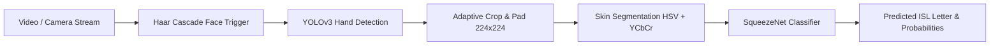

# Indian Sign Language (ISL) AI Translator

[](https://www.python.org/)
[](https://fastapi.tiangolo.com)
[](https://opencv.org/)
[](https://tensorflow.org/)

An end-to-end computer vision and deep learning application for translating Indian Sign Language (ISL) gestures into text in real time. Features a full-stack interactive web studio, live webcam stream processing, image/video upload support, and intermediate pipeline stage visualization.

---

## 🚀 Key Features

- **Live Webcam Translation Studio**: Real-time browser-based webcam stream with bounding boxes and continuous sign translation.
- **Deep 4-Stage Visualizer**: Inspect intermediate representations at every stage:
  1. **Raw Frame**: Initial camera or image capture.
  2. **YOLOv3 Hand Box**: Hand bounding box localization and confidence score.
  3. **Crop & Resize**: Centralized 224×224 normalized tensor input.
  4. **Skin Segmentation**: HSV + YCbCr background-subtracted binary mask.
- **5-Stage Pipeline Simulation**: Complete research workflow (Face detection trigger $\rightarrow$ 5s gesture recording $\rightarrow$ frame extraction $\rightarrow$ SqueezeNet consensus voting).
- **Multi-Input**: Supports live webcam feed, drag-and-drop images, and multi-frame video clips (.mp4, .mov).
- **Audio Output**: Integrated speech synthesis to pronounce translated letters aloud.
- **10 Supported ISL Classes**:
  `G`, `I`, `K`, `O`, `P`, `S`, `U`, `V`, `X`, `Y`

---

## 🧠 System Architecture



1. **Face Detection (Activation Trigger)**: Haar Cascades trigger video recording when the user is focused on the camera.
2. **Hand Detection (Localization)**: Darknet YOLOv3 network (`cross-hands`) detects hand regions and constructs bounding boxes.
3. **Preprocessing**: Extracted regions are padded, cropped, and resized to $224 \times 224$.
4. **Skin Segmentation (Noise Elimination)**: Combines HSV and YCbCr color thresholds with morphological watershed filtering to eliminate background clutter.
5. **Sign Recognition**: SqueezeNet convolutional neural network (fine-tuned via Transfer Learning) classifies the gesture across 10 distinct Indian Sign Language symbols.

---

## 📦 Quickstart & Installation

### 1. Clone the Repository
```bash
git clone https://github.com/PavanAksshay/pavan_sign_language.git
cd pavan_sign_language
```

### 2. Set Up Virtual Environment & Dependencies
```bash
python3 -m venv venv
source venv/bin/activate
pip install -r requirements.txt
```

### 3. Launch the Interactive Web Studio
```bash
python server.py
```
Open your browser and navigate to:
👉 **`http://localhost:8050`**

*(Note: YOLO weights `cross-hands.weights` (~246MB) are automatically downloaded on first launch if not present).*

---

## 📡 REST API Endpoints

| Method | Endpoint | Description |
| :--- | :--- | :--- |
| `GET` | `/` | Web Studio UI |
| `GET` | `/api/health` | Model and system readiness status |
| `GET` | `/api/classes` | Dictionary of supported ISL classes |
| `POST` | `/api/predict-image` | Full pipeline inference with 4-stage visual masks |
| `POST` | `/api/predict-stream-frame` | Low-latency endpoint for live streaming |
| `POST` | `/api/process-video` | Multi-frame video clip analysis & consensus voting |
| `POST` | `/api/detect-face` | Face detection trigger for activation phase |

---

## 📁 Repository Structure

```
pavan_sign_language/
├── App/
│   ├── final_model           # Trained SqueezeNet Keras HDF5 model
│   ├── model_class.json      # Class index mapping (10 ISL letters)
│   ├── preprocessing.py      # Skin segmentation & resizing routines
│   ├── select_final.py       # Consensus voting algorithms
│   ├── yolo.py               # Darknet YOLO inference handler
│   └── yolo_models/          # YOLOv3 configuration & model metadata
├── Dataset_Preprocessing/    # Dataset preprocessing scripts
├── Dataset_Synthesis/        # Synthetic data generation scripts
├── Model_Training/           # Jupyter notebook for SqueezeNet transfer learning
├── web/
│   ├── static/               # Built-in sample test images
│   └── templates/            # Web studio interface (index.html)
├── pipeline.py               # Core unified inference engine & auto-download
├── server.py                 # FastAPI application server
└── requirements.txt          # Python dependencies
```

---

## 🙏 Acknowledgments & Credits

- Based on the foundational Indian Sign Language Translator implementation by Abhishek Singh Dhadwal et al.
- Hand detection neural network weights by [Cansik](https://github.com/cansik/yolo-hand-detection/).
- Skin segmentation algorithm by [Jeanvit](https://github.com/Jeanvit/PySkinDetection).
