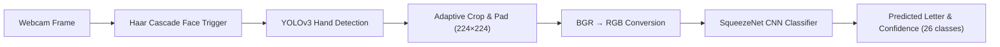
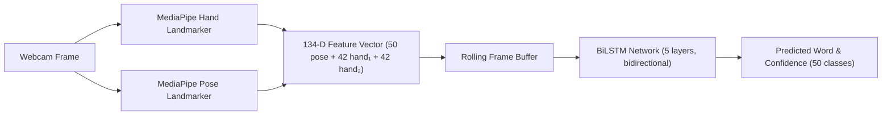

# Indian Sign Language (ISL) AI Translator

[](https://www.python.org/)
[](https://fastapi.tiangolo.com)
[](https://opencv.org/)
[](https://tensorflow.org/)
[](https://pytorch.org/)
[](https://ai.google.dev/edge/mediapipe)

An end-to-end computer vision and deep learning application for translating Indian Sign Language (ISL) gestures into text in real time. Features a dual-mode interactive web studio supporting both **fingerspelling (A-Z)** and **word-level sign recognition (50 words)**, with live webcam streaming, image/video upload, intermediate pipeline visualization, and speech-to-text input.

---

## 🚀 Key Features

- **Dual-Mode Translation Studio**:
  - **Fingerspelling Mode**: Real-time recognition of all 26 ISL alphabet letters (A–Z) using a SqueezeNet CNN classifier with **96.5% accuracy**.
  - **Word Mode**: Real-time recognition of 50 ISL word-level gestures using a BiLSTM temporal model with MediaPipe landmarks.
- **Deep 4-Stage Pipeline Visualizer**: Inspect intermediate representations at every stage:
  1. **Raw Frame** — Initial camera or image capture.
  2. **YOLOv3 Hand Box** — Hand bounding box localization and confidence score.
  3. **Crop & Resize** — Centralized 224×224 normalized tensor input.
  4. **Skin Segmentation** — HSV + YCbCr background-subtracted binary mask.
- **5-Stage Pipeline Simulation**: Complete research workflow (Face detection trigger → 5s gesture recording → frame extraction → SqueezeNet consensus voting).
- **Multi-Input Support**: Live webcam feed, drag-and-drop images, and multi-frame video clips (.mp4, .mov).
- **Speech-to-Text**: Integrated Moonshine STT model for voice input alongside sign language.
- **Audio Output**: Browser-native speech synthesis to pronounce translated letters and words aloud.
- **Interactive Manual & Catalog**: Visual reference for all 26 ISL letters and 50 word gestures with images organized by category.

---

## 🧠 System Architecture

### Fingerspelling Pipeline (Letters A–Z)



### Word-Level Pipeline (50 ISL Words)



### Processing Steps

1. **Face Detection (Activation Trigger)**: Haar Cascades trigger video recording when the user is focused on the camera.
2. **Hand Detection (Localization)**: Darknet YOLOv3 (`cross-hands`) detects hand regions and constructs bounding boxes. Supports both single-hand and two-handed ISL gestures via merged bounding boxes.
3. **Preprocessing**: Extracted regions are padded, cropped, resized to 224×224, and converted from BGR to RGB color space to match training distribution.
4. **Skin Segmentation (Noise Elimination)**: Combines HSV and YCbCr color thresholds with morphological watershed filtering to eliminate background clutter.
5. **Sign Recognition**:
   - **Letters**: SqueezeNet CNN (fine-tuned via Transfer Learning) classifies across 26 ISL alphabet classes.
   - **Words**: BiLSTM network processes temporal sequences of MediaPipe hand + pose landmarks across 50 word classes.

---

## 📦 Quickstart & Installation

### 1. Clone the Repository
```bash
git clone https://github.com/PavanAksshay/pavan_sign_language.git
cd pavan_sign_language
```

### 2. Set Up Virtual Environment & Dependencies
```bash
python3 -m venv venv
source venv/bin/activate
pip install -r requirements.txt
```

### 3. Launch the Interactive Web Studio
```bash
python server.py
```
Open your browser and navigate to:
👉 **`http://localhost:8050`**

*(Note: YOLO weights `cross-hands.weights` (~246MB) are automatically downloaded on first launch if not present.)*

---

## 📡 REST API Endpoints

| Method | Endpoint | Description |
| :--- | :--- | :--- |
| `GET` | `/` | Web Studio UI |
| `GET` | `/api/health` | Model and system readiness status |
| `GET` | `/api/classes` | Supported ISL letter classes (A–Z) |
| `GET` | `/api/words/classes` | Supported ISL word classes (50 words) |
| `POST` | `/api/predict-image` | Full pipeline inference with 4-stage visual masks |
| `POST` | `/api/predict-stream-frame` | Low-latency letter recognition for live streaming |
| `POST` | `/api/predict-word-frame` | Word-level frame processing with landmark extraction |
| `POST` | `/api/predict-word-clip` | Batch word recognition from multi-frame gesture clip |
| `POST` | `/api/reset-word-buffer` | Reset the word pipeline's rolling frame buffer |
| `POST` | `/api/process-video` | Multi-frame video clip analysis & consensus voting |
| `POST` | `/api/detect-face` | Face detection trigger for activation phase |
| `POST` | `/api/transcribe-speech` | Speech-to-text transcription via Moonshine STT |

---

## 📁 Repository Structure

```
pavan_sign_language/
├── App/
│   ├── final_model_26/         # Trained SqueezeNet model (26 ISL letters)
│   ├── model_class_26.json     # Class index mapping (A–Z)
│   ├── include50_model/        # BiLSTM model + MediaPipe tasks (50 words)
│   │   ├── include50_lstm.pth  # Trained BiLSTM weights
│   │   ├── label_map_include50.json
│   │   ├── word_catalog.json   # Word catalog with categories & images
│   │   ├── hand_landmarker.task
│   │   └── pose_landmarker.task
│   ├── include50_pipeline.py   # Word-level BiLSTM inference pipeline
│   ├── preprocessing.py        # Skin segmentation & resizing routines
│   ├── select_final.py         # Consensus voting algorithms
│   ├── yolo.py                 # Darknet YOLO inference handler
│   └── yolo_models/            # YOLOv3 configuration & weights
├── Dataset_Preprocessing/      # Dataset preprocessing scripts
├── Dataset_Synthesis/          # Synthetic data generation scripts
├── Model_Training/             # Jupyter notebook for SqueezeNet transfer learning
├── web/
│   ├── static/                 # Sample test images & word gesture images
│   └── templates/              # Web studio interface (index.html)
├── pipeline.py                 # Core letter-level inference engine
├── server.py                   # FastAPI application server
└── requirements.txt            # Python dependencies
```

