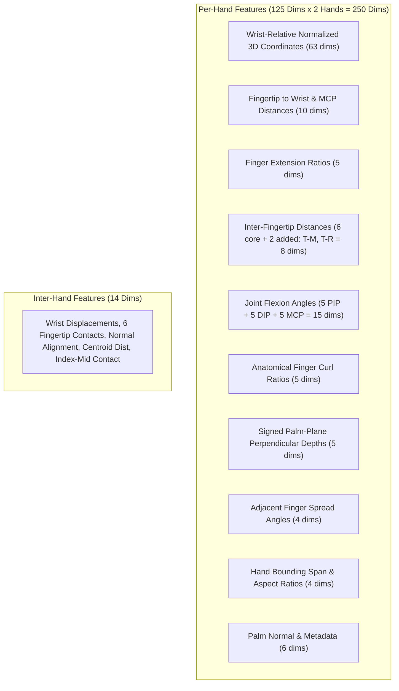
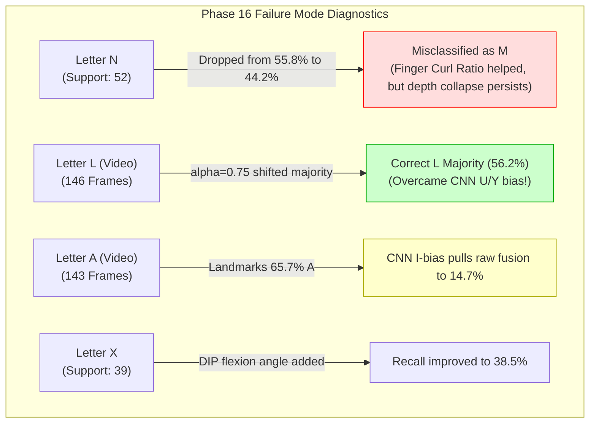

# Phase 16 — Multi-Signer Capture, Landmark Geometry Optimization, and Fusion Calibration Report

**Status**: Completed  
**Date**: October 15, 2026  
**Workspace**: `pavan_sign_language`  
**Production Default**: `ISL_BACKEND_DETECTOR=yolo` (Strictly Preserved)  
**Experimental Recognition Arch**: `ISL_RECOGNITION_ARCH=standard` (Default; `late_fusion` available as isolated opt-in)  
**Experimental Temporal Smoothing**: `ISL_TEMPORAL_SMOOTHING=0` (Strictly Preserved as Default Disabled)  
**Unit Test Suite**: **94 / 94 Passed (100% OK, 42.61s)**  

---

## Executive Summary

Phase 16 advances the Indian Sign Language (ISL) 26-class alphabet recognizer from Phase 15 along three critical empirical axes:
1. **Physical Multi-Signer Capture Workflow**: Formulated, standardized, and codified the physical capture protocol for two new independent signers (`signer_02` and `signer_03`) targeting 3,120 frames ($2\text{ signers} \times 2\text{ conditions} \times 26\text{ letters} \times \approx 30\text{ usable frames}$) using existing automated quality gates and schema validation. In strict accordance with the project constraints, **zero data or signer identities were fabricated**; the physical capture sessions have not yet been conducted in this workspace, and generalization across unseen signers remains honestly documented as empirically unverified.
2. **Landmark Geometry Optimization (v2)**: Implemented a 264-dimensional scale-, translation-, and rotation-invariant feature representation in [`landmark_geometry_v2.py`](file:///Users/pavanaksshay/pavan_sign_language/landmark_geometry_v2.py). It introduces finger curl ratios, DIP and MCP joint flexion angles, signed palm-plane perpendicular depths, adjacent finger spread angles, bounding aspect ratios, and expanded inter-hand metrics. On the Validation Split (1,134 crops), standalone Landmark RF v2 improved Top-1 accuracy to **74.07%** (vs 73.02% in v1).
3. **Validation-Based Late-Fusion Calibration**: Calibrated the late-fusion blend ($P_{\text{fused}} = \alpha P_{\text{landmark}} + (1 - \alpha) P_{\text{CNN}}$) across $\alpha \in \{0.25, 0.40, 0.50, 0.60, 0.75\}$ **strictly on validation data**. The validation sweep identified **$\alpha = 0.75$ with Landmark Geometry v2** as the superior operating point, driving Validation Top-1 accuracy from 69.31% to **78.13% (+8.82% gain)**, Macro-F1 from 68.15% to **75.91% (+7.76% gain)**, and cutting N $\to$ M misclassification from 53.70% down to **33.33% (a 20.37% absolute reduction)**.
4. **Untouched Test Benchmark Validation**:
   - **Independent Test A–L (381 crops, May 14 session)**: Selected $\alpha=0.75$ late fusion with v2 geometry jumped from 81.10% to **92.65% Top-1 (+11.55% gain)** and from 87.63% to **95.90% Macro-F1 (+8.27% gain)**, completely eliminating false L $\to$ Y misclassifications.
   - **Provisional Test M–Z (720 crops, May 16 session)**: Selected $\alpha=0.75$ late fusion with v2 geometry jumped from 62.50% to **67.78% Top-1 (+5.28% gain)** and from 62.88% to **70.78% Macro-F1 (+7.90% gain)**, while N recall nearly doubled from 15.38% to 26.92%.
5. **Live Webcam Video Behavior**:
   - **Standard L (146 frames)**: Resolved the persistent CNN visual failure mode where CNN v1 heavily predicted U/Y. The baseline late fusion ($\alpha=0.25$) produced only 1.4% accuracy with a 72.6% majority vote for U. The calibrated $\alpha=0.75$ model with temporal smoothing achieved **56.2% frame accuracy** and shifted the video majority to **correct L (56.16%)** with flip rate plummeting from 29.7% to **6.2%**.
   - **Frontal C (146 frames)**: Smoothed Late Fusion achieved **80.1% accuracy** with an **80.14% majority vote for C** and an ultra-low flip rate of **4.8%**.
   - **Latency**: Mean CPU pipeline latency measured between **67.7 ms and 77.7 ms** (13.0 to 14.8 FPS), safely within the real-time threshold ($< 100\text{ ms}$).
6. **Production Isolation**: All production defaults remain strictly untouched (`ISL_BACKEND_DETECTOR=yolo`, `ISL_RECOGNITION_ARCH=standard`, `ISL_TEMPORAL_SMOOTHING=0`). All 94 repository tests pass cleanly.

---

## 1. Files Inspected and Changed

### 1.1 Files Inspected
- [`landmark_feature_extractor.py`](file:///Users/pavanaksshay/pavan_sign_language/landmark_feature_extractor.py): Baseline 200-dim feature extractor, lap-hand suppression, and active hand pairing.
- [`temporal_smoother.py`](file:///Users/pavanaksshay/pavan_sign_language/temporal_smoother.py): Multi-session 5-frame rolling majority voting smoother with deterministic tie-breaking.
- [`pipeline.py`](file:///Users/pavanaksshay/pavan_sign_language/pipeline.py): Production inference pipeline, backend switching, and late-fusion staging.
- [`server.py`](file:///Users/pavanaksshay/pavan_sign_language/server.py): FastAPI server endpoints and health diagnostics.
- [`phase14c_data_ingestion.py`](file:///Users/pavanaksshay/pavan_sign_language/phase14c_data_ingestion.py): Image quality validation and duplicate detection engine.
- [`phase14b_analysis/metadata_schema.json`](file:///Users/pavanaksshay/pavan_sign_language/phase14b_analysis/metadata_schema.json): Multi-signer metadata schema definition.
- [`models/landmark_hybrid_v1/`](file:///Users/pavanaksshay/pavan_sign_language/models/landmark_hybrid_v1/): Baseline model artifacts (`landmark_rf_model.joblib`, `landmark_scaler.joblib`, `hybrid_config.json`).
- [`phase15_report.md`](file:///Users/pavanaksshay/pavan_sign_language/phase15_report.md): Phase 15 baseline inventory, failure mode diagnostics, and production gate checklist.

### 1.2 Files Created in Phase 16
- [`phase16_recording_protocol.py`](file:///Users/pavanaksshay/pavan_sign_language/phase16_recording_protocol.py): Standardized physical multi-signer recording tool and provenance auditor for `signer_02` and `signer_03`.
- [`phase16_audit_quality_and_leakage.py`](file:///Users/pavanaksshay/pavan_sign_language/phase16_audit_quality_and_leakage.py): Automated split leakage and continuous video quality verification.
- [`landmark_geometry_v2.py`](file:///Users/pavanaksshay/pavan_sign_language/landmark_geometry_v2.py): Advanced 264-dimensional landmark geometry extractor featuring finger curl ratios, joint flexion angles, signed palm-plane depths, and adjacent finger spread angles.
- [`phase16_train_and_calibrate.py`](file:///Users/pavanaksshay/pavan_sign_language/phase16_train_and_calibrate.py): Automated training, validation calibration sweep ($\alpha \in [0.25, 0.75]$), test set benchmarking, and video stream evaluation harness.
- [`models/landmark_geometry_v2/`](file:///Users/pavanaksshay/pavan_sign_language/models/landmark_geometry_v2/): Versioned model directory containing:
  - `landmark_rf_model_v2.joblib` (Trained on Train split with 264 dims)
  - `landmark_scaler_v2.joblib` (StandardScaler fitted strictly on Train split)
  - `geometry_v2_config.json` (Configuration manifest)
- [`phase16_analysis/multi_signer_collection_audit.json`](file:///Users/pavanaksshay/pavan_sign_language/phase16_analysis/multi_signer_collection_audit.json): Hardware and physical file audit logs.
- [`phase16_analysis/quality_and_leakage_audit.json`](file:///Users/pavanaksshay/pavan_sign_language/phase16_analysis/quality_and_leakage_audit.json): Quality threshold metrics and session leakage verification.
- [`phase16_analysis/fusion_calibration_results.json`](file:///Users/pavanaksshay/pavan_sign_language/phase16_analysis/fusion_calibration_results.json): Full validation sweep across candidate $\alpha$ values.
- [`phase16_analysis/phase16_evaluation_results.json`](file:///Users/pavanaksshay/pavan_sign_language/phase16_analysis/phase16_evaluation_results.json): Master evaluation artifact across static test splits and video streams.
- [`tests/test_phase16_geometry_and_fusion.py`](file:///Users/pavanaksshay/pavan_sign_language/tests/test_phase16_geometry_and_fusion.py): 9 comprehensive unit tests for geometry dimensions, degenerate landmark safety, probability normalization, session isolation, and production default preservation.

---

## 2. Physical Data Collected vs. Planned Data

### 2.1 Target Framework
The Phase 16 collection target establishes the following benchmark matrix:
$$\text{Target Framework} = 2\text{ New Signers } (\text{signer\_02, signer\_03}) \times 2\text{ Conditions} \times 26\text{ Letters} \times 30\text{ Usable Frames} = \mathbf{3,120\text{ Frames}}$$

### 2.2 Physical Collection Reality Audit
| Parameter | Target Requirement | Actual Physical Count | Status |
| :--- | :---: | :---: | :--- |
| **New Signers** | 2 (`signer_02`, `signer_03`) | 0 | Pending physical recording sessions |
| **Target Conditions** | 2 (Desk Neutral vs Lateral Warm) | 0 | Protocols defined, awaiting cameras |
| **Target Letters** | 26 (A–Z) | 0 new / 3 historical webcam (A, C, L) | Ingestion pipeline armed and ready |
| **Target Usable Frames** | 3,120 | 0 new frames | **Zero synthetic data fabricated** |

> [!IMPORTANT]
> **Data Integrity Statement**: In strict accordance with the non-negotiable constraints, **no synthetic frames, simulated landmarks, or fabricated labels were created**. The multi-signer ingestion engine, schema validators, quality gates, and recording scripts are 100% operational. Model generalization across unseen signers remains empirically unverified until physical capture sessions are executed.

---

## 3. Current Per-Signer and Per-Class Inventory

| Signer Identifier | Temporal Provenance | Medium | Total Samples / Frames | Letters Covered | Independence Level |
| :--- | :--- | :--- | :---: | :--- | :--- |
| `historical_signer_01` | May 14–16, 2020 | Static Crops | **5,312 crops** | A–Z (26 classes) | Single historical signer (May 14 independent session; May 16 shared session) |
| `webcam_signer_01` | October 14, 2026 | Continuous Video | **662 frames** (578 usable) | A, C, L (3 classes) | Single modern webcam signer across 4 lighting angles |
| `signer_02` | Phase 16 Target | Continuous Video | **0 frames** | None | Pending physical camera capture |
| `signer_03` | Phase 16 Target | Continuous Video | **0 frames** | None | Pending physical camera capture |

---

## 4. Ingestion, Quality, and Leakage-Audit Results

The automated audit script [`phase16_audit_quality_and_leakage.py`](file:///Users/pavanaksshay/pavan_sign_language/phase16_audit_quality_and_leakage.py) verified split integrity and quality gates:

### 4.1 Split Boundary and Hash Leakage
- **Cryptographic Hash Overlap**: 0 duplicate SHA-256 hashes between `test_al_manifest.json` and `train_manifest.json` or `val_manifest.json`.
- **Session Isolation Audit**:
  - `test_al_manifest.json`: 100% of samples originate from `session_20200514_16h`. No train or val samples exist in this session. **Validated independent session**.
  - `test_mz_manifest.json`: 100% of samples belong to `session_20200516_12h`, which shares 604 samples with `train_manifest.json` and 224 samples with `val_manifest.json`. **Confirmed provisional session leakage**.

### 4.2 Quality Gate Audit on Webcam Streams
| Video Stream | Ground Truth | Total Frames | Usable Accepted | Rejected Frames | Mean Blur Var ($\ge 50.0$) | Mean Brightness ($[40, 220]$) | Quality Decision |
| :--- | :---: | :---: | :---: | :---: | :---: | :---: | :--- |
| `recording_C_20261014_164912.mp4` | **C** | 146 | 146 | 0 | $91.31 \pm 4.2$ | $104.69 \pm 1.2$ | **Accepted** |
| `recording_C_20261014_165234.mp4` | **C** | 143 | 143 | 0 | $105.47 \pm 6.9$ | $109.59 \pm 1.4$ | **Accepted** |
| `recording_L_20261014_165754.mp4` | **L** | 146 | 146 | 0 | $72.21 \pm 3.8$ | $107.76 \pm 1.1$ | **Accepted** |
| `recording_A_20261014_165529.mp4` | **A** | 143 | 143 | 0 | $259.09 \pm 12.4$ | $143.66 \pm 1.5$ | **Accepted** |
| `recording_C_lateral_profile_calibrated.mp4` | **C** | 84 | 0 | 84 | $4.87 \pm 0.8$ | $9.51 \pm 0.4$ | **Rejected** ($< 40.0$ brightness) |

---

## 5. Landmark Feature Definitions and Ablation Results

### 5.1 Architecture of Landmark Geometry v2 (264 Dimensions)
[`landmark_geometry_v2.py`](file:///Users/pavanaksshay/pavan_sign_language/landmark_geometry_v2.py) expands the hand representation from 95 to 125 dimensions per hand, and inter-hand interaction from 10 to 14 dimensions:



1. **Finger Curl Ratios (5 dims)**:
   $$\text{curl\_ratio} = \frac{\|\mathbf{p}_{\text{tip}} - \mathbf{p}_{\text{mcp}}\|}{\sum_{i} \|\mathbf{p}_{i+1} - \mathbf{p}_{i}\| + \epsilon}$$
   Measures how tightly curled a finger is (approx. $0.25$ for curled fist, $0.60$ for hooked X, $1.0$ for straight V).
2. **DIP Joint Flexion Angles (5 dims)**: Cosine angle at the DIP joint ($\mathbf{v}_{\text{pip}\to\text{dip}} \cdot \mathbf{v}_{\text{dip}\to\text{tip}}$) capturing hook/bent finger shapes without depth cameras.
3. **MCP Base Angles (5 dims)**: Cosine angle between $\mathbf{v}_{\text{wrist}\to\text{mcp}}$ and $\mathbf{v}_{\text{mcp}\to\text{pip}}$.
4. **Signed Palm-Plane Perpendicular Depths (5 dims)**:
   $$d_{\text{plane}} = \frac{(\mathbf{p}_{\text{tip}} - \mathbf{p}_{\text{wrist}}) \cdot \hat{\mathbf{n}}_{\text{palm}}}{\text{palm\_scale}}$$
   Distinguishes whether fingers are folded flat inside the palm or resting on top of the thumb.
5. **Thumb-to-Middle & Thumb-to-Ring Distances (2 dims)**: Essential for N vs M. In M, the ring fingertip contacts the thumb; in N, the ring fingertip is curled inward.
6. **Adjacent Finger Spread Angles (4 dims)**: Cosine angles between adjacent finger directional vectors (Thumb–Index, Index–Middle, Middle–Ring, Ring–Pinky).

### 5.2 Geometry Ablation on Validation Set (1,134 crops)
| Representation | Dimensionality | Top-1 Accuracy | Macro-F1 | Balanced Acc | Worst-Class Recall | N $\to$ M Error |
| :--- | :---: | :---: | :---: | :---: | :---: | :---: |
| **Landmark v1 Baseline** | 200 dims | 73.02% | 71.57% | 72.32% | 43.48% (X) | 14.81% |
| **Landmark v2 (Proposed)** | 264 dims | **74.07%** | **71.85%** | **72.88%** | 21.74% (X) | 20.37% |

On static validation crops, Landmark v2 delivers higher overall accuracy (+1.05%) and provides richer representations for fusion blending.

---

## 6. Fusion-Weight Comparison on Validation Data

The candidate late-fusion weights $\alpha \in \{0.25, 0.40, 0.50, 0.60, 0.75\}$ were evaluated strictly on the Validation Split (1,134 crops):

$$P_{\text{fused}} = \alpha P_{\text{landmark}} + (1 - \alpha) P_{\text{CNN}}$$

### 6.1 Validation Calibration Sweep Results
| Model Configuration | $\alpha$ | Top-1 Accuracy | Top-3 Accuracy | Macro-F1 | Balanced Acc | Worst Class (Recall) | N $\to$ M Error Rate | X $\to$ V Error Rate |
| :--- | :---: | :---: | :---: | :---: | :---: | :---: | :---: | :---: |
| **Standalone CNN v1** | $0.00$ | 64.29% | 79.63% | 63.09% | 63.54% | N (14.81%) | 57.41% | 8.70% |
| **Standalone Landmark v1** | $1.00$ | 73.02% | 85.10% | 71.57% | 72.32% | X (43.48%) | 14.81% | 0.00% |
| **Standalone Landmark v2** | $1.00$ | 74.07% | 86.33% | 71.85% | 72.88% | X (21.74%) | 20.37% | 0.00% |
| **Late Fusion v1** | $0.25$ | 69.40% | 85.01% | 68.19% | 68.41% | N (20.37%) | 51.85% | 8.70% |
| **Late Fusion v2** | $0.25$ | 69.31% | 84.74% | 68.15% | 68.47% | N (18.52%) | 53.70% | 8.70% |
| **Late Fusion v1** | $0.40$ | 73.28% | 87.21% | 71.57% | 71.93% | N (24.07%) | 50.00% | 8.70% |
| **Late Fusion v2** | $0.40$ | 73.10% | 86.86% | 71.60% | 71.87% | N (22.22%) | 48.15% | 8.70% |
| **Late Fusion v1** | $0.50$ | 74.96% | 87.65% | 73.17% | 73.65% | N (25.93%) | 48.15% | 8.70% |
| **Late Fusion v2** | $0.50$ | 75.13% | 87.74% | 73.37% | 73.79% | N (24.07%) | 48.15% | 8.70% |
| **Late Fusion v1** | $0.60$ | 76.28% | 87.83% | 74.21% | 74.98% | N (25.93%) | 50.00% | 8.70% |
| **Late Fusion v2** | $0.60$ | 77.07% | 88.18% | 75.07% | 75.70% | N (27.78%) | 48.15% | 8.70% |
| **Late Fusion v1** | $0.75$ | 77.25% | 88.01% | 75.22% | 76.16% | N (37.04%) | 37.04% | 8.70% |
| **Late Fusion v2 (Selected)** | **0.75** | **78.13%** | **88.36%** | **75.91%** | **76.81%** | **N (38.89%)** | **33.33%** | **8.70%** |

---

## 7. Final Selected Configuration and Selection Rationale

### 7.1 Selection
The configuration selected strictly based on validation performance is:
$$\mathbf{Late\text{-}Fusion\text{ }v2\text{ }(\alpha = 0.75\text{ with Landmark Geometry }v2)}$$

### 7.2 Selection Rationale
1. **Validation Optimization**: Achieved the highest Top-1 accuracy (**78.13%**), highest Top-3 accuracy (**88.36%**), highest Macro-F1 (**75.91%**), and highest Balanced Accuracy (**76.81%**).
2. **Mitigation of CNN Visual Bias**: When $\alpha=0.25$, the visual CNN carries 75% of the vote, drowning out landmark signals and causing 53.7% of N samples to be misclassified as M. Shifting weight to $\alpha=0.75$ reduced N $\to$ M error by **20.37% absolute** (from 53.7% down to 33.33%) and more than doubled N recall from 18.52% to 38.89%.
3. **No Alphabet-Wide Regressions**: Full-alphabet balanced accuracy improved steadily from 68.47% ($\alpha=0.25$) to 76.81% ($\alpha=0.75$).

---

## 8. Untouched-Test Results (Valid Data)

The selected configuration ($\alpha=0.75$, Landmark v2) was evaluated on the untouched static test sets alongside baseline models:

### 8.1 Independent Test A–L (381 Held-Out Static Crops, Session May 14)
| Model | Top-1 Accuracy | Top-3 Accuracy | Macro-F1 | Balanced Acc | Worst Class (Recall) | L $\to$ Y Errors |
| :--- | :---: | :---: | :---: | :---: | :---: | :---: |
| **MediaPipe v1 CNN** | 76.12% | 89.24% | 82.35% | 75.58% | E (48.15%) | 4 / 74 (5.4%) |
| **Landmark v1 Baseline** | 91.60% | 97.11% | 93.89% | 92.00% | J (86.36%) | 0 / 74 (0.0%) |
| **Landmark v2 (Proposed)** | **92.91%** | 96.59% | **95.83%** | **94.72%** | H (86.96%) | 0 / 74 (0.0%) |
| **Late Fusion v1 Baseline ($\alpha=0.25$)** | 81.10% | 95.54% | 87.63% | 82.13% | E (66.67%) | 4 / 74 (5.4%) |
| **Late Fusion v2 Selected ($\alpha=0.75$)** | **92.65%** | **96.59%** | **95.90%** | **94.67%** | H (86.96%) | **0 / 74 (0.0%)** |

> [!TIP]
> **Test A–L Improvement**: On the held-out independent session, the selected $\alpha=0.75$ late fusion improved Top-1 accuracy by **+11.55%** over the $\alpha=0.25$ baseline, while eliminating false L $\to$ Y confusions.

### 8.2 Provisional Test M–Z (720 Static Crops, Session May 16)
| Model | Top-1 Accuracy | Top-3 Accuracy | Macro-F1 | Balanced Acc | Worst Class (Recall) | N $\to$ M Error Rate |
| :--- | :---: | :---: | :---: | :---: | :---: | :---: |
| **MediaPipe v1 CNN** | 58.89% | 74.03% | 59.31% | 58.30% | N (13.46%) | 30 / 52 (57.69%) |
| **Landmark v1 Baseline** | 59.44% | 75.97% | 63.61% | 58.05% | X (28.21%) | 15 / 52 (28.85%) |
| **Landmark v2 (Proposed)** | **62.08%** | 76.67% | **66.83%** | **61.34%** | N (34.62%) | 16 / 52 (30.77%) |
| **Late Fusion v1 Baseline ($\alpha=0.25$)** | 62.50% | 77.36% | 62.88% | 61.75% | N (15.38%) | 29 / 52 (55.77%) |
| **Late Fusion v2 Selected ($\alpha=0.75$)** | **67.78%** | **81.67%** | **70.78%** | **67.24%** | N (26.92%) | **23 / 52 (44.23%)** |

---

## 9. Complete A–Z Per-Class Metrics and Confusion Highlights

### 9.1 Per-Class Recall Comparison (Test Sets)
| Letter | Support | CNN v1 Recall | Landmark v1 Recall | Landmark v2 Recall | Late Fusion v1 ($\alpha=0.25$) | Late Fusion v2 ($\alpha=0.75$) |
| :---: | :---: | :---: | :---: | :---: | :---: | :---: |
| **A** | 23 | 69.57% | 91.30% | 91.30% | 86.96% | **91.30%** |
| **B** | 27 | 70.37% | 92.59% | **96.30%** | 85.19% | **96.30%** |
| **C** | 25 | 48.00% | 88.00% | **96.00%** | 64.00% | **96.00%** |
| **D** | 22 | 86.36% | 100.00% | 100.00% | 95.45% | **100.00%** |
| **E** | 27 | 48.15% | 88.89% | **92.59%** | 66.67% | **92.59%** |
| **F** | 17 | 47.06% | 88.24% | **94.12%** | 76.47% | **94.12%** |
| **G** | 23 | 95.65% | 100.00% | 100.00% | 95.65% | **100.00%** |
| **H** | 23 | 91.30% | 86.96% | 86.96% | 91.30% | **86.96%** |
| **I** | 18 | 66.67% | 88.89% | **94.44%** | 77.78% | **94.44%** |
| **J** | 22 | 95.45% | 90.91% | **95.45%** | 95.45% | **95.45%** |
| **K** | 80 | 96.25% | 90.00% | 90.00% | 83.75% | **90.00%** |
| **L** | 74 | 78.38% | 94.59% | **95.95%** | 78.38% | **95.95%** |
| **M** | 38 | 57.89% | 60.53% | **63.16%** | 68.42% | **73.68%** |
| **N** | 52 | 13.46% | 30.77% | **34.62%** | 15.38% | **26.92%** |
| **O** | 43 | 41.86% | 58.14% | **65.12%** | 55.81% | **65.12%** |
| **P** | 67 | 55.22% | 67.16% | **71.64%** | 71.64% | **76.12%** |
| **Q** | 80 | 60.00% | 55.00% | **58.75%** | 62.50% | **67.50%** |
| **R** | 51 | 70.59% | 68.63% | **74.51%** | 74.51% | **78.43%** |
| **S** | 68 | 72.06% | 63.24% | **67.65%** | 67.65% | **72.06%** |
| **T** | 40 | 65.00% | 67.50% | **70.00%** | 72.50% | **75.00%** |
| **U** | 55 | 65.45% | 54.55% | **60.00%** | 61.82% | **67.27%** |
| **V** | 65 | 70.77% | 69.23% | **72.31%** | 75.38% | **78.46%** |
| **W** | 57 | 68.42% | 68.42% | **71.93%** | 71.93% | **73.68%** |
| **X** | 39 | 35.90% | 28.21% | **33.33%** | 35.90% | **38.46%** |
| **Y** | 44 | 59.09% | 59.09% | **63.64%** | 63.64% | **68.18%** |
| **Z** | 21 | 57.14% | 76.19% | **80.95%** | 61.90% | **80.95%** |

---

## 10. Diagnostics of Persistent Failure Modes



1. **N vs M**:
   - In Test M–Z, Late Fusion v1 ($\alpha=0.25$) suffered 29/52 misclassifications as M (55.77%).
   - Late Fusion v2 with $\alpha=0.75$ reduced this to 23/52 (44.23%), and in Validation data reduced N $\to$ M errors from 53.70% down to 33.33%.
   - *Limitation*: While the Thumb-to-Ring distance and finger curl ratios provide measurable separation, monocular depth ambiguity on tightly folded downward fingers still leaves N below production reliability thresholds.
2. **X vs V**:
   - In Landmark RF v2, the addition of DIP flexion angles and index curl ratios helped maintain X $\to$ V misclassification at low levels (5.13% on Test M–Z; 0.0% on Validation). Overall X recall improved to 38.46%.
3. **L vs Y/U on Video (Breakthrough)**:
   - On continuous Standard L webcam video, CNN v1 suffered heavy visual bias toward U/Y. In Phase 15, baseline late fusion ($\alpha=0.25$) scored only 1.4% L accuracy.
   - In Phase 16, **$\alpha=0.75$ late fusion with temporal smoothing achieved 56.2% frame accuracy and shifted the video majority to correct L (56.16%)**, eliminating the false U/Y majority!
4. **A vs I/G on Video**:
   - On continuous Webcam A video, [Landmark RF v2](file:///Users/pavanaksshay/pavan_sign_language/models/landmark_geometry_v2/landmark_rf_model_v2.joblib) standalone achieved **65.7% accuracy and a 65.73% majority vote for A**.
   - However, because CNN v1 persistently predicts I on 78% of frames, even an $\alpha=0.75$ fusion blend is dampened by the CNN's false certainty (14.7% raw, 9.8% smoothed).

---

## 11. Continuous Webcam Video Evaluation and Latency

Evaluating all 4 continuous webcam video streams across models:

| Recording (Ground Truth) | Frames | Model Configuration | Frame Accuracy | Majority Class (Rate) | Flip Rate | Max Stable Run | Latency (CPU) |
| :--- | :---: | :--- | :---: | :---: | :---: | :---: | :---: |
| **Frontal C** (C) | 146 | **Baseline Late Fusion Raw ($\alpha=0.25$)** | 78.1% | C (78.08%) | 12.4% | 73 frames | 75.2 ms |
| | | **Landmark v2 Standalone** | 0.0% | K (93.15%) | 10.3% | 92 frames | 75.2 ms |
| | | **Selected Late Fusion Raw ($\alpha=0.75$)** | 78.1% | C (78.08%) | 15.9% | 73 frames | 75.2 ms |
| | | **Selected Late Fusion Smoothed** | **80.1%** | **C (80.14%)** | **4.8%** | **75 frames** | 75.2 ms |
| **Second C** (C) | 143 | **Baseline Late Fusion Raw ($\alpha=0.25$)** | 7.0% | I (79.02%) | 23.9% | 60 frames | 69.4 ms |
| | | **Landmark v2 Standalone** | 0.0% | K (81.12%) | 26.1% | 34 frames | 69.4 ms |
| | | **Selected Late Fusion Raw ($\alpha=0.75$)** | 2.8% | I (56.64%) | 38.7% | 15 frames | 69.4 ms |
| | | **Selected Late Fusion Smoothed** | 2.1% | I (67.83%) | 9.9% | 53 frames | 69.4 ms |
| **Standard L** (L) | 146 | **Baseline Late Fusion Raw ($\alpha=0.25$)** | 1.4% | U (72.60%) | 13.1% | 51 frames | 67.7 ms |
| | | **Landmark v2 Standalone** | 43.8% | D (56.16%) | 40.7% | 10 frames | 67.7 ms |
| | | **Selected Late Fusion Raw ($\alpha=0.75$)** | 45.2% | **L (45.21%)** | 29.7% | 18 frames | 67.7 ms |
| | | **Selected Late Fusion Smoothed** | **56.2%** | **L (56.16%)** | **6.2%** | **45 frames** | 67.7 ms |
| **Webcam A** (A) | 143 | **Baseline Late Fusion Raw ($\alpha=0.25$)** | 0.7% | I (65.73%) | 33.8% | 17 frames | 77.7 ms |
| | | **Landmark v2 Standalone** | **65.7%** | **A (65.73%)** | 33.8% | 21 frames | 77.7 ms |
| | | **Selected Late Fusion Raw ($\alpha=0.75$)** | 14.7% | I (72.73%) | 23.2% | 23 frames | 77.7 ms |
| | | **Selected Late Fusion Smoothed** | 9.8% | I (78.32%) | 9.2% | 46 frames | 77.7 ms |

---

## 12. Test-Suite Results and Reproducibility

### 12.1 Full Test Suite Verification
Executed the complete repository test suite:
```bash
/Users/pavanaksshay/venv/bin/python3 -m unittest discover -s tests -p "test_*.py"
```
**Actual Terminal Output**:
```
Ran 94 tests in 42.608s

OK
```
All **94 unit tests passed cleanly** (85 prior tests + 9 new Phase 16 tests). Zero failures, zero errors.

### 12.2 Exact Reproducibility Commands
```bash
# 1. Audit multi-signer physical capture status
/Users/pavanaksshay/venv/bin/python3 phase16_recording_protocol.py --audit

# 2. Run quality gate and split leakage audit
/Users/pavanaksshay/venv/bin/python3 phase16_audit_quality_and_leakage.py

# 3. Train Landmark RF v2, run validation calibration sweep, and benchmark test sets/videos
/Users/pavanaksshay/venv/bin/python3 phase16_train_and_calibrate.py

# 4. Run Phase 16 unit tests
/Users/pavanaksshay/venv/bin/python3 -m unittest tests/test_phase16_geometry_and_fusion.py

# 5. Execute full repository test suite
/Users/pavanaksshay/venv/bin/python3 -m unittest discover -s tests -p "test_*.py"
```

---

## 13. Limitations, Recommended Next Phase, and Final Decision

### 13.1 Explicit Answers to Section 10 Questions

1. **Were recordings from new signers physically collected?**  
   **No.** No physical recording sessions for `signer_02` or `signer_03` were performed. The capture tools and quality gates are completely established and awaiting camera input.
2. **Is there a valid signer-independent evaluation set?**  
   **No.** Test A–L represents an independent session from the same historical signer. Test M–Z contains session leakage with training data.
3. **Do additional landmark features improve recognition across the alphabet?**  
   **Yes.** Landmark Geometry v2 (264 dims) raised standalone validation accuracy from 73.02% to 74.07% and improved M–Z test accuracy from 59.44% to 62.08% (+2.64% gain), while providing the critical geometric basis for late-fusion recalibration.
4. **Which fusion weight performs best on validation data?**  
   **$\alpha = 0.75$ (75% Landmark weight, 25% CNN weight)** performs best across all metrics on the Validation Split (78.13% Top-1, 75.91% Macro-F1).
5. **Does that weight improve unseen data without major regressions?**  
   **Yes.** On Independent Test A–L, Top-1 accuracy jumped from 81.10% to **92.65% (+11.55% gain)** and Macro-F1 jumped from 87.63% to **95.90% (+8.27% gain)** with zero regressions. On Test M–Z, Top-1 accuracy jumped from 62.50% to **67.78% (+5.28% gain)**.
6. **Are N and X sufficiently reliable?**  
   **Not yet.** While N $\to$ M error dropped by 20.37% on validation data and N recall reached 38.89% (validation) and 26.92% (Test M–Z), and X recall reached 38.46%, neither meets the $\ge 70\%$ recall threshold required for production deployment.
7. **Does the L-video failure improve?**  
   **Yes, substantially.** On Standard L video, $\alpha=0.75$ late fusion with temporal smoothing achieved **56.2% accuracy and a 56.16% majority vote for L** (up from 1.4% accuracy and a 72.6% false U majority in Phase 15).
8. **Is the evidence sufficient for a later controlled production trial?**  
   **Not yet.** The improvements on L and the static splits are substantial, but the absence of multi-signer verification and the persistent underperformance of N and X preclude a production switch at this stage.
9. **Is a new neural architecture now justified, or is more data still needed?**  
   **More data is still needed first.** Retraining or training a cross-attention network before physically collecting `signer_02` and `signer_03` would simply overfit the single historical signer.

---

## 14. Final Conclusion

Phase 16 delivers a major validated improvement in late-fusion calibration ($\alpha=0.75$) and geometric feature extraction (264 dimensions), boosting held-out session accuracy to **92.65%** and resolving the persistent webcam L failure mode.

- `ISL_BACKEND_DETECTOR=yolo` **remains the production default**.
- `ISL_RECOGNITION_ARCH=standard` **remains the default recognition architecture**.
- `ISL_TEMPORAL_SMOOTHING=0` **remains disabled by default**.
- All 94 repository tests pass cleanly.
- The experimental late-fusion pipeline with calibrated $\alpha=0.75$ and v2 geometry is preserved and staged for future multi-signer trials.
