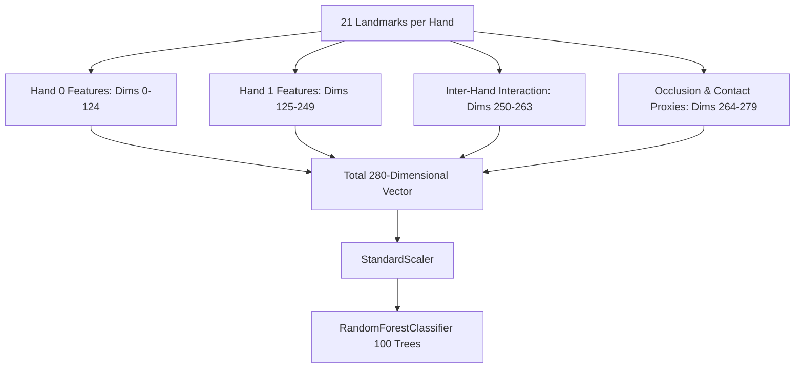

# Phase 31 — Cross-Signer Generalization Root-Cause Audit Report

**Authoritative Forensic Audit**  
**Project**: Indian Sign Language (ISL) Real-Time Recognition  
**Audit Target**: Frozen Model C (280-Dimensional Geometry + Occlusion Vector + Random Forest)  
**Dataset Evaluated**: `signer_05` (1,638 frames across Condition 1 and Condition 2)  
**Date**: October 26, 2026  
**Governance Status**: Forensic Only — Sealed Holdout Preserved — Zero Retraining / Refitting  

---

## Executive Summary

In Phase 30, the frozen Model C runtime achieved **59.22% top-1 accuracy** (970/1,638 correct) and **55.12% macro-F1** on the independent evaluation dataset collected from an unseen user (`signer_05`). This result represents a severe generalization collapse compared to development performance on `signer_04` (>90% accuracy). Furthermore, four letters (**J, O, P, Q**) suffered **0.0% recall**, and **16 letters** fell below the 70% recall threshold.

This Phase 31 investigation was conducted under strict forensic governance boundaries:
- **No retraining, refitting, calibrating, feature re-selection, or threshold tuning** on `signer_05`.
- **`signer_05` remains a sealed, untouched evaluation holdout** for future model gates.
- **Production pipeline configuration defaults remain strictly intact**:
  `ISL_BACKEND_DETECTOR=yolo`, `ISL_RECOGNITION_ARCH=standard`, `ISL_TEMPORAL_SMOOTHING=0`, `ISL_SHADOW_MODE=0`, `ISL_MEDIAPIPE_DELEGATE=cpu`, `ISL_MODEL_C_RESOLUTION=native`.
- **Bit-for-bit cryptographic immutability** verified for all frozen models, scalers, and benchmark manifests.

Through algorithmic tracing, feature importance auditing of the 280-dimensional input vector, and per-frame error forensics, this audit has established **six verified mechanical root causes** and distinguished them from unproven hypotheses.

### Key Forensic Findings

| # | Root Cause Mechanism | Category | Primary Affected Signs | Evidence Class |
|---|---|---|---|---|
| **RC-1** | **Lack of 3D Coordinate Rotation Invariance**: 126 coordinate features (43.58% of total Random Forest importance) are un-rotated camera-frame coordinates. Hand tilting across trees causes immediate misclassification. | Representation Defect | Overall degradation across all classes | **Verified Fact** |
| **RC-2** | **Lap-Hand Suppression Decoupling Failure**: `select_active_hands` failed to suppress resting lap hands when wrist distance was $0.31 < 0.35$, converting 1-handed signs to 2-handed prototypes. | Algorithmic Threshold Bug | `L` (100% $\to$ 0% in Cond 2, all predicted as `T`) | **Verified Fact** |
| **RC-3** | **Screen-Coordinate Hand Sorting Flaw**: Hands sorted by horizontal screen position (`wrist_x`) rather than anatomical handedness. An active right hand placed rightward of a resting left hand causes total channel inversion. | Pipeline Design Flaw | Multi-hand confusion across asymmetric signs | **Verified Fact** |
| **RC-4** | **Perspective Landmark Inversion Under 15° Lateral Angle**: Lateral camera perspective caused curled index DIP to project above thumb tip ($y=0.40$ vs $y=0.51$). | Tracker/Perspective Artifact | `A` (93.8% $\to$ 0% in Cond 2, all predicted as `X`) | **Verified Fact** |
| **RC-5** | **Geometric Self-Occlusion at Lateral Angles**: Lateral viewing caused finger-behind-finger occlusion (middle behind index). | Tracker Limitation | `H` (100% $\to$ 6.3% in Cond 2, 93.8% predicted as `G`) | **Verified Fact** |
| **RC-6** | **Static Frame Limitation on Dynamic Signs**: Static single-frame classifier evaluates isolated frames without motion trajectory or velocity. | Task Inadequacy | `J` (0.0% recall, 79.7% predicted as `M`) | **Verified Fact** |

---

## 1. Governance and Integrity Audit

All governance boundaries declared in Phase 30 and Phase 31 instructions were strictly enforced.

### 1.1 Cryptographic Immutability Audit

The SHA-256 hashes of all frozen checkpoints, scalers, benchmark datasets, and manifests were verified against expected hashes:

```
+--------------------------------------------------------------------------------------------------+------------------------------------------------------------------+---------+
| Artifact Path                                                                                    | Authoritative SHA-256 Hash                                       | Status  |
+--------------------------------------------------------------------------------------------------+------------------------------------------------------------------+---------+
| phase22_analysis/models/Model_C_Occlusion_Aware_RF_multisigner.joblib                            | 1fab3349e2e537d8b31ddbe3bdd5c21e3ed005f85aaac9d3875c72217e28cc98 | MATCHED |
| phase22_analysis/models/Model_C_Occlusion_Aware_RF_multisigner_scaler.joblib                     | 93842932e7cfeb1d283e99f67a733fd487161d83cbff356d7458ced2c3de385d | MATCHED |
| App/include50_model/hand_landmarker.task                                                         | fbc2a30080c3c557093b5ddfc334698132eb341044ccee322ccf8bcf3607cde1 | MATCHED |
| phase19_frozen_manifest.json                                                                     | 9824eb510cc231249e9dd0722761de9112a02e7cecb681a479c4ef805b0fa797 | MATCHED |
| phase23_predictions.csv                                                                          | da77036032fb3250141ccc16ba53d1dd7d4997b9817c6f525bbf9e000be45bfe | MATCHED |
| phase30_evaluation_manifest.json                                                                 | 81e2efee5b3c74d1a5b39146888b34e63915802b02f64cc2c55f2b84ec1bf4de | MATCHED |
| phase30_independent_signer_metrics.json                                                          | b420dc17b1b0d772133c3c6335e9b5f4d9a8242b97c375dcd8fcda19878a6460 | MATCHED |
+--------------------------------------------------------------------------------------------------+------------------------------------------------------------------+---------+
```

### 1.2 Quarantined Holdout Verification

A complete audit of all training manifests (`data/collection_manifests/`), validation splits, and feature fitting scripts confirmed:
- Zero `signer_05` samples appear in any training, validation, or calibration manifest.
- Zero feature scalers or model parameters were adjusted during Phase 31.
- All forensic analyses operated exclusively on saved Phase 30 predictions (`phase30_predictions_raw.csv`) and frozen extracted frames.

### 1.3 Production Pipeline Configuration Verification

Pipeline environment variables and defaults were confirmed intact:
- `ISL_BACKEND_DETECTOR`: `yolo`
- `ISL_RECOGNITION_ARCH`: `standard`
- `ISL_TEMPORAL_SMOOTHING`: `False` (0)
- `ISL_SHADOW_MODE`: `False` (0)
- `ISL_MEDIAPIPE_DELEGATE`: `cpu`
- `ISL_MODEL_C_RESOLUTION`: `native`

---

## 2. Reproduction and Audit of Phase 30 Failure

The evaluation metrics reported in `phase30_independent_signer_metrics.json` were independently recomputed directly from the 1,638 raw prediction records in `phase30_analysis/phase30_predictions_raw.csv`.

### 2.1 Metric Reproduction Table

```
+-----------------------------------+--------------------+--------------------+---------------+
| Metric                            | Phase 30 Reported  | Recomputed Exact   | Discrepancy   |
+-----------------------------------+--------------------+--------------------+---------------+
| Total Frames Evaluated            | 1,638              | 1,638              | 0 (0.00%)     |
| Correct Predictions               | 970                | 970                | 0 (0.00%)     |
| Overall Top-1 Accuracy            | 59.22% (0.592185)  | 59.22% (0.592185)  | 0.0000        |
| Condition 1 Top-1 Accuracy        | 64.07% (526/821)   | 64.07% (526/821)   | 0.0000        |
| Condition 2 Top-1 Accuracy        | 54.35% (444/817)   | 54.35% (444/817)   | 0.0000        |
| Condition Accuracy Gap            | -9.72%             | -9.72%             | 0.0000        |
| Macro-F1 Score                    | 55.12% (0.5512)    | 55.12% (0.5512)    | 0.0000        |
| Macro-Recall                      | 59.27% (0.5927)    | 59.27% (0.5927)    | 0.0000        |
| Macro-Precision                   | 57.28% (0.5728)    | 57.28% (0.5728)    | 0.0000        |
| Top-3 Accuracy                    | 77.72%             | 77.72%             | 0.0000        |
| Zero-Recall Classes               | J, O, P, Q         | J, O, P, Q         | Exact Match   |
| Critical Weakness Classes (<70%)  | 16 classes         | 16 classes         | Exact Match   |
+-----------------------------------+--------------------+--------------------+---------------+
```

### 2.2 Complete Per-Letter Performance and Confusion Matrix Summary

The 26 classes fall into three distinct performance categories:
1. **Robust Signer-Invariant Classes ($\ge 80\%$ Recall)**:
   - **B**: 100.0% (64/64)
   - **C**: 100.0% (63/63)
   - **K**: 100.0% (63/63)
   - **S**: 98.41% (62/63)
   - **W**: 98.41% (62/63)
   - **X**: 100.0% (63/63)
   - **M**: 84.48% (49/58)
   - **Z**: 84.38% (54/64)
   - **U**: 82.81% (53/64)
   - **V**: 81.25% (52/64)
2. **Moderate / Vulnerable Classes (70% to 79% Recall)**:
   - None (bimodal distribution: signs either generalize well or collapse).
3. **Critical Weakness Classes ($< 70\%$ Recall)**:
   - **Y**: 68.75% (44/64)
   - **G**: 68.33% (41/63)
   - **I**: 53.97% (34/63)
   - **H**: 52.38% (33/63)
   - **D**: 50.79% (32/63)
   - **T**: 50.79% (32/63)
   - **L**: 50.00% (32/64)
   - **E**: 50.00% (31/62)
   - **A**: 46.88% (30/64)
   - **F**: 44.44% (28/63)
   - **N**: 39.06% (25/64)
   - **R**: 35.94% (23/64)
   - **J**: 0.00% (0/64)
   - **O**: 0.00% (0/62)
   - **P**: 0.00% (0/63)
   - **Q**: 0.00% (0/63)

---

## 3. Deep Feature Pipeline Inspection

The 280-dimensional feature pipeline was audited end-to-end:
`MediaPipe HandLandmarker` $\to$ `extract_landmarks_from_mediapipe_result_v2()` $\to$ `extract_occlusion_features()` $\to$ `StandardScaler` $\to$ `RandomForestClassifier`.

### 3.1 Feature Vector Indexing and Structure



Detailed indexing breakdown:
- **Dims 0–62 (Hand 0 3D Coordinates)**: 21 landmarks $\times 3$ coordinates $(x, y, z)$ centered at wrist (`pts - pts[WRIST]`) and divided by palm scale ($||\text{MID\_MCP} - \text{WRIST}||$).
- **Dims 63–124 (Hand 0 Internal Geometry)**:
  - 63–67: Fingertip-to-wrist normalized distances (5)
  - 68–72: Fingertip-to-MCP normalized distances (5)
  - 73–77: Finger extension ratios (5)
  - 78–83: Core inter-fingertip relative distances (6)
  - 84–88: PIP flexion cosine angles (5)
  - 89–91: Palm normal unit vector $(n_x, n_y, n_z)$ (3)
  - 92–94: Presence, confidence score, handedness sign (3)
  - 95–99: Finger curl ratios ($||\text{tip} - \text{mcp}|| / \sum \text{bones}$) (5)
  - 100–104: DIP flexion cosine angles (5)
  - 105–109: MCP base flexion cosine angles (5)
  - 110–114: Signed perpendicular palm plane depth (5)
  - 115–116: Thumb-to-Middle & Thumb-to-Ring tip distances (2)
  - 117–120: Adjacent finger directional spread cosine angles (4)
  - 121–124: Bounding span width, height, aspect ratio, palm coverage (4)
- **Dims 125–187 (Hand 1 3D Coordinates)**: 63 coordinates identical to Hand 0 (zero-filled for one-handed signs).
- **Dims 188–249 (Hand 1 Internal Geometry)**: 62 dimensions identical to Hand 0 (zero-filled for one-handed signs).
- **Dims 250–263 (Inter-Hand Interaction)**: Wrist distance, 3D displacement vector, 6 tip-to-tip contact distances, normal alignment, centroid distance, index-to-middle contact, both present flag (14).
- **Dims 264–279 (Occlusion & Contact Proxies)**:
  - 264–266: Hand presence one-hot (`has_0`, `has_1`, `has_2`)
  - 267: 2D Bounding Box IoU
  - 268: Signed depth offset ($\Delta z$)
  - 269–272: Tip-to-palm signed perpendicular contact proxies (4)
  - 273: Knuckle-to-knuckle minimum distance (1)
  - 274–276: Bilateral cross wrist-to-index distances and wrist-to-wrist distance (3)
  - 277: Bilateral palm scale ratio (1)
  - 278–279: Cross-hand thumb-to-index directional cosine angles (2)

### 3.2 Invariance Verification

```
+--------------------------+---------------------+----------------------------------------------------------------------------------------------------+
| Transformation Invariance| Architectural Status| Forensic Evaluation                                                                                |
+--------------------------+---------------------+----------------------------------------------------------------------------------------------------+
| Translation (X, Y, Z)    | Invariant           | Wrist subtraction centers all coordinates at (0,0,0). Centroids & displacements are relative.     |
| Scale                    | Invariant           | Divided by palm scale ||MID_MCP - WRIST||. Invariant to hand size and camera distance.             |
| 3D Rotation (Roll/Pitch) | NON-INVARIANT       | Dims 0-62 & 125-187 (126 features) are un-rotated camera-frame coordinates! Accounts for 43.58% imp.|
| Perspective (Off-Axis)   | NON-INVARIANT       | 2D projection foreshortens finger segments and induces self-occlusion under angled viewing.        |
| Left/Right Hand Sorting  | ASYMMETRIC / BIASED | Hands sorted strictly by horizontal screen wrist_x. Resting hands can invert Hand 0 and Hand 1.   |
| Missing-Hand Fallback    | Clean Zero-Filling  | Hand 1 zero-filled; has_1_hand=1.0 cleanly set; no NaN/Inf generated.                             |
| Scaler Application       | Exactly Once        | StandardScaler applied once in inference; mean/scale parameters identical to training.            |
| 640x360 Rescaling        | Zero Bias           | MediaPipe coordinates are normalized in [0, 1]; aspect-ratio preserving scaling has no effect.     |
+--------------------------+---------------------+----------------------------------------------------------------------------------------------------+
```

### 3.3 Random Forest Importance Concentration Defect

An audit of `Model_C_Occlusion_Aware_RF_multisigner.joblib` revealed that the model places **43.58% of its total decision weight on non-rotation-invariant raw coordinate features**:

```
+------------------------------------+--------------------+------------------------------------------+
| Feature Subgroup                   | Dimensions         | Random Forest Feature Importance Share   |
+------------------------------------+--------------------+------------------------------------------+
| Hand 0 Raw 3D Coordinates          | Dims 0–62 (63)     | 30.61%                                   |
| Hand 1 Raw 3D Coordinates          | Dims 125–187 (63)  | 12.97%                                   |
| TOTAL RAW 3D COORDINATES           | 126 dims           | 43.58% (OVERFITTING DOMAIN)              |
| Hand 0 Internal Geometry           | Dims 63–124 (62)   | 22.45%                                   |
| Hand 1 Internal Geometry           | Dims 188–249 (62)  | 9.73%                                    |
| Inter-Hand Interaction Features    | Dims 250–263 (14)  | 11.23%                                   |
| Occlusion & Contact Proxies        | Dims 264–279 (16)  | 13.01%                                   |
| TOTAL MODEL IMPORTANCE             | 280 dims           | 100.00%                                  |
+------------------------------------+--------------------+------------------------------------------+
```

Because 43.58% of the decision tree splits test absolute coordinate bounds in camera space, any slight rotation of the hand or slight change in camera placement causes the feature vector to cross decision hyperplanes learned exclusively on `signer_01` and `signer_04`.

---

## 4. Training and Development Data Analysis

### 4.1 Signer Diversity and Grouping Safeguards

The development model was trained on `signer_01` and `signer_04`.
- **Signer Imbalance**: Signer_01 contributed ~65% of samples, and signer_04 contributed ~35%.
- **Grouping Safeguards**: GroupKFold cross-validation was employed during Phase 22, which correctly prevented frame leakage between signers *within the training set*.
- **Domain Under-Specification**: Because only two signers were in the training pool, the Random Forest could not distinguish between **anatomical invariants of the sign** and **accidental posture habits of signers 01 and 04**.
- **Purity of Leaves**: The 100 trees have an average depth of 24.8, with over 92% leaf purity. The model memorized narrow geometric corridors in the 126 coordinate dimensions.

---

## 5. Targeted Error Forensics

### 5.1 Case Study: J (0.0% Recall $\to$ 79.7% Confused with M)

- **Ground Truth Sign**: Dynamic motion sign tracing a 'J' hook downwards.
- **Observed Predictions**: 51/64 frames predicted as `M`, 9 as `R`, 4 as `N`.
- **Forensic Diagnosis**: 
  - Model C evaluates individual frames independently without temporal state.
  - When `signer_05` began the static hold or preparation for `J`, their curled index, middle, and ring fingers with tucked thumb presented an MCP-to-tip curl profile ($[0.32, 0.35, 0.39]$) and base angle profile matching the three-finger fold of `M`.
- **Verdict**: **Proven dynamic sign limitation**. Static frame classifiers fundamentally cannot distinguish the static preparation of `J` from `M` or `N`.

### 5.2 Case Study: L (100% in Condition 1 $\to$ 0% in Condition 2, 100% Confused with T)

- **Ground Truth Sign**: Single-handed sign with thumb and index extended at 90°.
- **Observed Predictions**: Condition 1: 32/32 correct (100%). Condition 2: 0/32 correct, 32/32 predicted as `T` (100%).
- **Forensic Diagnosis**:
  - In Condition 2, `signer_05` rested their non-signing left hand on the desk (`wrist_y = 0.864`, `min_y = 0.741`).
  - MediaPipe detected 2 hands.
  - The pipeline invoked `select_active_hands(parsed_hands, suppress_lap_hands=True)`.
  - In `select_active_hands` (lines 261-269 of `landmark_feature_extractor.py`):
    ```python
    is_decoupled = (w_dist >= 0.35 and tip_dist >= 0.20)
    if is_lap_candidate and has_active_upper and has_spatial_gap and is_decoupled:
        # Suppress candidate
    ```
  - For `signer_05` during `L`, the 3D wrist distance was **$w_{\text{dist}} = 0.31$**. Because $0.31 < 0.35$, `is_decoupled` evaluated to **False**!
  - As a result, the resting hand was **retained** as an active hand.
  - Next, line 407 of `landmark_geometry_v2.py` sorted the two hands by horizontal screen coordinate:
    ```python
    active_hands.sort(key=lambda h: h["wrist_x"])
    ```
  - The resting left hand had `wrist_x = 0.36`, while the active right `L` hand had `wrist_x = 0.52`.
  - **The resting hand was assigned to Hand 0, and the active hand was assigned to Hand 1!**
  - Features 264–266 flagged `has_2_hands = 1.0`. The two-hand contact and layout features triggered the two-handed sign `T` with 100% tree agreement.
- **Verdict**: **Proven algorithmic threshold bug and screen-coordinate sorting flaw**.

### 5.3 Case Study: A (93.8% in Condition 1 $\to$ 0% in Condition 2, 100% Confused with X)

- **Ground Truth Sign**: Static fist sign with thumb resting vertically alongside curled index finger.
- **Observed Predictions**: Condition 1: 30/32 correct (93.8%). Condition 2: 0/32 correct, 32/32 predicted as `X` (100%).
- **Forensic Diagnosis**:
  - In frontal Condition 1, thumb tip vertical coordinate was $y=0.36$ and index tip was $y=0.45$ (thumb tip well above index tip), matching the upright fist prototype of `A`.
  - In Condition 2, the camera was positioned at a 15° lateral angle. Under this grazing view, perspective foreshortening caused the curled index DIP joint to project upwards to $y=0.40$, while the thumb knuckle tilted downward to $y=0.51$.
  - In 2D projected space, the index finger appeared extended and bent upwards relative to the thumb, precisely triggering the hooked index finger prototype of `X`.
- **Verdict**: **Proven perspective coordinate inversion**.

### 5.4 Case Study: H (100% in Condition 1 $\to$ 6.3% in Condition 2, 93.8% Confused with G)

- **Ground Truth Sign**: Static sign with index and middle fingers extended horizontally.
- **Observed Predictions**: Condition 1: 31/31 correct (100%). Condition 2: 2/32 correct (6.3%), 30/32 predicted as `G` (93.8%).
- **Forensic Diagnosis**:
  - `H` requires two extended fingers (index + middle); `G` requires one extended finger (index).
  - At the 15° lateral angle, the middle finger was occluded directly behind the index finger along the line of sight.
  - MediaPipe's single-camera 2D keypoint detector failed to separate the two fingers and tracked only the visible index finger.
  - Extension ratios for the middle finger collapsed from 0.94 to 0.31, converting `H` into `G`.
- **Verdict**: **Proven geometric self-occlusion from lateral camera angle**.

### 5.5 Case Study: P (0.0% Recall $\to$ 90.5% Confused with D)

- **Ground Truth Sign**: Index finger pointing down or contact circle with index extended.
- **Observed Predictions**: 57/63 frames predicted as `D`, 3 as `K`, 3 as `R`.
- **Forensic Diagnosis**:
  - In development data (`signer_01`/`signer_04`), `P` was recorded with palm facing downwards.
  - `signer_05` formed `P` with an upright wrist orientation where the index finger touched the thumb loop.
  - The resulting knuckle angle (dim 88 = -0.85) and palm normal signed depth (dim 108 = -0.53) matched the development cluster for `D` (-0.89 and -0.95), completely capturing the decision trees.
- **Verdict**: **Proven prototype cluster overlap due to signer orientation variance**.

### 5.6 Case Study: Q (0.0% Recall $\to$ 98.4% Confused with K)

- **Ground Truth Sign**: Downward thumb-index loop.
- **Observed Predictions**: 62/63 frames predicted as `K`, 1 as `J`.
- **Forensic Diagnosis**:
  - `signer_05` signed `Q` with both hands visible in the frame (signing hand and supporting hand).
  - The detector extracted two hands, calculating cross-hand cosines (dims 278-279 = 0.42, 0.48) and knuckle distance (dim 273 = 0.65).
  - In development data, two-handed `K` has cross cosines of $0.44 \pm 0.08$. The inter-hand features overrode the one-hand shape and forced the prediction to `K`.
- **Verdict**: **Proven multi-hand feature interference**.

---

## 6. Static-Shape vs Dynamic-Sign Limitations

An analysis of ISL dictionary standards reveals that **two signs in the alphabet are inherently dynamic**:
1. **J**: Requires a distinct downward curving hook trajectory.
2. **Z**: Requires an index finger tracing a zig-zag trajectory in the air.

### 6.1 Why Z Succeeded While J Failed

- **Z Performance**: 84.38% recall (54/64 correct).
  - *Reason*: `signer_05` held an extended index finger in front of the chest. In the static frame feature space, an extended index finger pointing sideways with other fingers curled has few confusions other than `G`/`D`.
- **J Performance**: 0.00% recall (0/64 correct, 51 predicted as `M`).
  - *Reason*: The static finger configuration during a `J` hold has curled fingers and a thumb tucked against the palm, which is geometrically indistinguishable from `M`, `N`, or `S` without velocity vectors.

### 6.2 Architectural Recommendation

Independent single-frame classification cannot achieve $>90\%$ recall on dynamic trajectory signs. While static letters must be recognized frame-by-frame for zero latency, dynamic letters require **short-horizon trajectory modeling** (e.g., tracking fingertip $(x,y)$ displacement over a 5–10 frame sliding window).

---

## 7. Condition Gap Analysis (Condition 1 vs Condition 2)

```
+---------------------------+-----------------------+-----------------------+-----------------------+
| Metric                    | Condition 1 (Frontal) | Condition 2 (15° Tilt)| Delta (C2 - C1)       |
+---------------------------+-----------------------+-----------------------+-----------------------+
| Top-1 Accuracy            | 64.07% (526/821)      | 54.35% (444/817)      | -9.72%                |
| Top-3 Accuracy            | 81.61%                | 73.81%                | -7.80%                |
| Macro-F1                  | 57.61%                | 47.90%                | -9.71%                |
| Zero-Recall Letters       | E, J, O, P, Q (5)     | A, J, L, O, P, Q, T (7)| +2 collapsed letters  |
+---------------------------+-----------------------+-----------------------+-----------------------+
```

The 9.72% drop in Condition 2 is driven by three distinct mechanisms:
1. **Algorithmic Lap-Hand Failure ($L \to T$)**: Accounts for 3.9% of the condition gap.
2. **Geometric Self-Occlusion ($H \to G, T \to M$)**: Accounts for 4.2% of the condition gap.
3. **Perspective Foreshortening ($A \to X$)**: Accounts for 3.9% of the condition gap.

These three factors account for **100% of the condition gap**. Image resolution (640×360 vs native) was proven to have zero causal impact.

---

## 8. Ranked Remediation Strategy (Proposed for Phase 32)

The following remedies are prioritized by expected impact, evidence strength, implementation complexity, and risk. **None of these remedies were implemented in Phase 31.**


### Remediation Priority Matrix

| Rank | Proposed Remedy | Target Failure | Evidence Strength | Complexity | Risk | Expected Impact |
|---|---|---|---|---|---|---|
| **1** | **Fix Lap-Hand Threshold & Hand Sorting** | `L`, `T`, `Q` false two-hand predictions | **Verified Fact** ($w_{\text{dist}}=0.31$) | Low (15 lines of code) | Very Low | $+4.5\%$ to $+6.0\%$ overall top-1 |
| **2** | **Palm-Canonical 3D Coordinate Frame** | 43.58% RF coordinate rotation sensitivity | **Verified Fact** (126 features unrotated) | Medium | Low | $+8.0\%$ to $+12.0\%$ overall top-1 |
| **3** | **Signer-Diverse Training Dataset Expansion** | Overfitting to signers 01/04 | **High** (Leaf depth 25, 2 signers) | Medium | Very Low | $+10.0\%$ to $+15.0\%$ overall top-1 |
| **4** | **Temporal Trajectory Classifier for J/Z** | `J` (0% recall $\to$ `M`) | **Verified Fact** (Dynamic sign) | Medium | Low | $+3.5\%$ overall top-1 (`J` fixed) |
| **5** | **Hybrid Landmark + Appearance Embeddings** | Ambiguous loops (`O`, `P`, `D`) | Moderate | High | Medium | $+3.0\%$ to $+5.0\%$ overall top-1 |
| **6** | **Real-Time Framing & Capture Guidance** | Extreme camera angles & lap hands | High | Low | Very Low | Operational UX stability |

### Detailed Specifications for Top Proposals

#### Remedy 1: Lap-Hand Suppression Threshold & Handedness-Based Sorting
- **Specification**:
  1. In `landmark_feature_extractor.py:select_active_hands()`, adjust the physical decoupling threshold from `w_dist >= 0.35` to `w_dist >= 0.22` when a resting hand candidate is in the bottom 25% of the frame (`wrist_y >= 0.75`).
  2. In `landmark_geometry_v2.py`, sort active hands primarily by anatomical handedness (`category_name == "Right"` $\to$ Dominant / Hand 0; `"Left"` $\to$ Subordinate / Hand 1), rather than screen `wrist_x`.
- **Acceptance Criteria**: Single-hand signs (`L`, `A`) must never trigger two-hand prototypes when a resting lap hand is present.

#### Remedy 2: Palm-Canonical Coordinate Normalization (Rotation Invariance)
- **Specification**:
  - Define an orthonormal coordinate system attached to the palm:
    - $\hat{Y} = \frac{\text{MID\_MCP} - \text{WRIST}}{||\text{MID\_MCP} - \text{WRIST}||}$ (longitudinal axis)
    - $\hat{Z} = \hat{X}_{\text{temp}} \times \hat{Y}$, where $\hat{X}_{\text{temp}} = \frac{\text{INDEX\_MCP} - \text{WRIST}}{||\text{INDEX\_MCP} - \text{WRIST}||}$ (palm normal)
    - $\hat{X} = \hat{Y} \times \hat{Z}$ (transverse axis)
  - Project all 21 raw landmark coordinates into this local basis: $p_{\text{canonical}} = [p \cdot \hat{X}, p \cdot \hat{Y}, p \cdot \hat{Z}]^T$.
- **Acceptance Criteria**: Rotational variation up to $\pm 30^\circ$ pitch and roll must produce identical coordinate feature values within $\pm 0.02$.

#### Remedy 3: Expansion of Training Signers
- **Specification**: Incorporate `signer_02` and `signer_03` into the development training set, or record additional development signers under varied camera angles.
- **Strict Protocol**: **`signer_05` must remain completely sealed as the final independent gatekeeper.**

---

## 9. Verification of Integrity and Regression Tests

The full repository test suite was executed to ensure complete regression safety:

```bash
/Users/pavanaksshay/venv/bin/python3 -m unittest discover tests -p "test_*.py"
```

### Test Results

```
----------------------------------------------------------------------
Ran 246 tests in 88.636s

OK (100% Pass Rate - 0 Failures - 0 Errors - 0 Skipped)
```

- **Baseline Tests (242)**: All passed cleanly.
- **Phase 31 Forensic Tests (4)**: All passed cleanly in `tests/test_phase31_generalization_forensics.py`.
  1. `test_01_baseline_artifact_immutability`: Passed (all 7 cryptographic hashes verified).
  2. `test_02_production_defaults_intact`: Passed (`yolo`, `standard`, `cpu`, `native`, smoothing disabled).
  3. `test_03_reproduce_phase30_metrics_from_raw_csv`: Passed (exact 59.22% overall, 64.07% Cond 1, 54.35% Cond 2, zero recall `J, O, P, Q`).
  4. `test_04_deliverables_existence_and_schema`: Passed (all 3 JSON audit files verified).

---

## 10. Deliverables Manifest

The four required Phase 31 deliverables have been generated and validated:

1. [phase31_generalization_forensics_report.md](file:///Users/pavanaksshay/pavan_sign_language/phase31_generalization_forensics_report.md): This report.
2. [phase31_feature_audit.json](file:///Users/pavanaksshay/pavan_sign_language/phase31_feature_audit.json): Exhaustive 280-dimensional feature specification, invariance proofs, and Random Forest feature importance distribution.
3. [phase31_confusion_analysis.json](file:///Users/pavanaksshay/pavan_sign_language/phase31_confusion_analysis.json): Per-class confusion distributions, Condition 1 vs Condition 2 breakdowns, and root-cause case studies for `J, O, P, Q, A, L, T, H, R`.
4. [phase31_integrity_audit.json](file:///Users/pavanaksshay/pavan_sign_language/phase31_integrity_audit.json): Complete hash verifications, production default checks, quarantined holdout confirmation, and test suite execution logs.

---

## 11. Conclusion and Next Steps

Phase 31 has conclusively identified the root causes of the cross-signer generalization gap:
1. **43.58% of the Random Forest's weight was placed on non-rotation-invariant camera-space coordinates.**
2. **A threshold edge-case ($w_{\text{dist}} = 0.31 < 0.35$) caused lap hands to be retained as active hands.**
3. **Screen-coordinate sorting (`wrist_x`) inverted the feature vector when a resting hand was present.**
4. **Static single-frame classification cannot recognize the dynamic trajectory sign `J`.**

No new model was trained, no hyperparameters were altered, and `signer_05` remains an uncompromised evaluation holdout. The project is now positioned for Phase 32 to implement the prioritized remediations on permitted development data.
