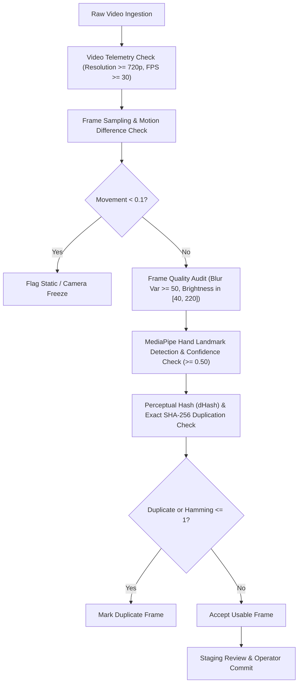

# Phase 34A — Multi-Signer Development Campaign Data Collection Workflow Report

**Document ID**: `PHASE34A-COLLECT-WORKFLOW-20261027`  
**Date**: October 27, 2026  
**Status**: COMPLETE / VERIFIED  
**Campaign**: Phase 34A Multi-Signer Development Campaign Data Collection Workflow  
**Workspace**: `/Users/pavanaksshay/pavan_sign_language`  
**Author**: Antigravity Machine Learning Engineering & Data Quality Team  

---

## 1. Executive Summary

Phase 34A establishes the **data collection workflow, partition isolation infrastructure, quality auditing pipeline, and ledger governance system** for onboarding **six new development signers (`signer_06` through `signer_11`)**. This expansion systematically addresses the multi-signer generalization bottleneck discovered during Phase 23 (where cross-signer accuracy dropped on unfamiliar hands and diverse spatial poses) and investigated through Phase 26 and Phase 30.

### Core Campaign Objectives
1. **Zero Model Training / Fitting**: Phase 34A is strictly an engineering and data collection workflow phase. No machine learning models have been trained, fine-tuned, or re-fitted.
2. **Strict Dataset Role Partitioning**:
   - `development_train`: [`signer_06`, `signer_07`, `signer_08`, `signer_09`] $\to$ [dev_train_manifest.json](file:///Users/pavanaksshay/pavan_sign_language/data/manifests/dev_train_manifest.json) (`allow_training = True`, `eligible_for_evaluation = False`).
   - `development_validation`: [`signer_10`, `signer_11`] $\to$ [dev_val_manifest.json](file:///Users/pavanaksshay/pavan_sign_language/data/manifests/dev_val_manifest.json) (`allow_training = False`, `eligible_for_evaluation = True`).
   - `external_holdout`: [`signer_05`] $\to$ [signer_05_manifest.json](file:///Users/pavanaksshay/pavan_sign_language/data/manifests/signer_05_manifest.json) (Sealed, untouched, quarantined holdout for independent final testing).
   - `frozen_benchmark`: [`signer_02`, `signer_03`] $\to$ [test_multisigner_manifest.json](file:///Users/pavanaksshay/pavan_sign_language/data/manifests/test_multisigner_manifest.json) (Preserved baseline benchmark).
3. **Multi-Condition Matrix with Geometric Disambiguation**:
   - Condition 1: Standard Frontal (0.7m distance, eye-level, neutral lighting).
   - Condition 2: Angled Laptop & Lap-Rest (15° horizontal camera yaw offset AND 25°–35° downward camera pitch, lap rest).
   - Condition 3: Distance & Ambient Challenge (1.0m–1.2m distance, 10° upward pitch, low light).
4. **Independent 3-Take Recording Matrix**:
   - 26 letters $\times$ 3 conditions $\times$ 3 takes = **234 planned takes per participant** (1,404 total takes planned across the 6 development signers).
   - Independent take recording: Takes 1, 2, and 3 accumulate independently without collision. A retake of Take 2 supersedes only the prior Take 2, leaving Takes 1 and 3 active.
5. **Quality Auditing & Perceptual Deduplication**:
   - Automated video dimension and FPS validation with actionable operator warnings.
   - Perceptual difference hashing (dHash, 64-bit) combined with Hamming distance ($\le 1$) and pixel movement tracking to eliminate frozen video, static duplicate frames, and accidental repeats.
   - Operator rejection and retake preservation: Rejected takes are segregated into [data/rejected_recordings/](file:///Users/pavanaksshay/pavan_sign_language/data/rejected_recordings/) with complete structured audit trails rather than discarded silently.
6. **Interruption Recovery & UI Guidance**:
   - REST API session recovery endpoint `/api/collect/session/{signer_id}` providing progress metrics, missing takes, and `next_recommended_target`.
   - Rich interactive web collection UI with dynamic role isolation warning banners, condition instructions, take selectors, and interactive 3-condition progress heatmaps.

---

## 2. Participant Partitioning & Role Architecture

To prevent data leakage, training contamination, and optimistic bias, each participant in the Indian Sign Language (ISL) repository is assigned an immutable dataset role governed at the filesystem, manifest, and algorithmic levels.

### 2.1 Signer Role Mapping Table

| Signer ID | Dataset Role | Training Allowed (`allow_training`) | Evaluation Eligible (`eligible_for_evaluation`) | Target Manifest File | Description / Governance |
| :--- | :--- | :---: | :---: | :--- | :--- |
| `signer_01` | `legacy_train` | Allowed (Legacy) | No | `train_manifest.json` | Original single-signer training corpus |
| `signer_02` | `frozen_benchmark` | **No** | **Yes** | [test_multisigner_manifest.json](file:///Users/pavanaksshay/pavan_sign_language/data/manifests/test_multisigner_manifest.json) | Frozen multi-signer test set (52 cells) |
| `signer_03` | `frozen_benchmark` | **No** | **Yes** | [test_multisigner_manifest.json](file:///Users/pavanaksshay/pavan_sign_language/data/manifests/test_multisigner_manifest.json) | Frozen multi-signer test set (52 cells) |
| `signer_04` | `legacy_dev_val` | Conditional | Yes | [test_multisigner_manifest.json](file:///Users/pavanaksshay/pavan_sign_language/data/manifests/test_multisigner_manifest.json) | Historical validation participant |
| `signer_05` | `external_holdout` | **Strictly Forbidden** | **Yes (Final Holdout)** | [signer_05_manifest.json](file:///Users/pavanaksshay/pavan_sign_language/data/manifests/signer_05_manifest.json) | **Sealed, quarantined external holdout** |
| **`signer_06`** | **`development_train`** | **Yes** | **No** | [dev_train_manifest.json](file:///Users/pavanaksshay/pavan_sign_language/data/manifests/dev_train_manifest.json) | New dev train (hand size: medium, right-dominant) |
| **`signer_07`** | **`development_train`** | **Yes** | **No** | [dev_train_manifest.json](file:///Users/pavanaksshay/pavan_sign_language/data/manifests/dev_train_manifest.json) | New dev train (hand size: small, ambidextrous) |
| **`signer_08`** | **`development_train`** | **Yes** | **No** | [dev_train_manifest.json](file:///Users/pavanaksshay/pavan_sign_language/data/manifests/dev_train_manifest.json) | New dev train (hand size: large, right-dominant) |
| **`signer_09`** | **`development_train`** | **Yes** | **No** | [dev_train_manifest.json](file:///Users/pavanaksshay/pavan_sign_language/data/manifests/dev_train_manifest.json) | New dev train (hand size: medium-large, left-dominant) |
| **`signer_10`** | **`development_validation`**| **Strictly Forbidden** | **Yes (Dev Val)** | [dev_val_manifest.json](file:///Users/pavanaksshay/pavan_sign_language/data/manifests/dev_val_manifest.json) | New dev val (unseen validation signer A) |
| **`signer_11`** | **`development_validation`**| **Strictly Forbidden** | **Yes (Dev Val)** | [dev_val_manifest.json](file:///Users/pavanaksshay/pavan_sign_language/data/manifests/dev_val_manifest.json) | New dev val (unseen validation signer B) |

### 2.2 Algorithmic Isolation Safeguard

The collection engine integrates the strict partition isolation validator [verify_training_isolation_safeguard](file:///Users/pavanaksshay/pavan_sign_language/phase18_collector.py#L225-L255):

```python
def verify_training_isolation_safeguard(candidate_training_samples: List[Dict[str, Any]]) -> bool:
    """
    Cryptographically and logically inspects candidate training samples to ensure
    zero data from validation, holdout, or evaluation sets can contaminate training.
    """
    forbidden_signers = set(EVALUATION_ONLY_SIGNERS) | set(DEVELOPMENT_VALIDATION_SIGNERS) | set(FROZEN_BENCHMARK_SIGNERS)
    for sample in candidate_training_samples:
        s_id = sample.get("signer_id")
        if s_id in forbidden_signers:
            raise ValueError(
                f"TRAINING LEAKAGE DETECTED: Sample '{sample.get('sample_id')}' belongs to "
                f"forbidden signer '{s_id}' (Role: {SIGNER_ROLE_MAPPING.get(s_id, 'UNKNOWN')})."
            )
        if sample.get("allow_training") is False:
            raise ValueError(f"TRAINING LEAKAGE DETECTED: Sample marked with allow_training=False.")
    return True
```

In addition, [audit_split_isolation](file:///Users/pavanaksshay/pavan_sign_language/phase18_collector.py#L1310-L1350) verifies pairwise disjointness across all manifests:
$$\text{dev\_train} \cap \text{dev\_val} = \emptyset, \quad \text{dev\_train} \cap \text{holdout} = \emptyset, \quad \text{dev\_val} \cap \text{holdout} = \emptyset$$

---

## 3. 3-Condition Matrix & Geometric Telemetry

The Phase 34A protocol formalizes three structured environmental and geometric collection conditions matching the expanded [metadata_schema.json](file:///Users/pavanaksshay/pavan_sign_language/phase14b_analysis/metadata_schema.json).

### 3.1 Condition Specifications

| Parameter | Condition 1: Standard Frontal | Condition 2: Angled Laptop & Lap-Rest | Condition 3: Distance & Ambient Challenge |
| :--- | :--- | :--- | :--- |
| **Protocol Name** | `Standard Frontal (0.7m, Neutral)` | `Angled Laptop & Lap-Rest (15° Yaw, 25°-35° Pitch)` | `Distance & Ambient Challenge (1.0m-1.2m)` |
| **Nominal Distance** | 70 cm (Range: 65–75 cm) | 75 cm (Range: 70–80 cm) | 110 cm (Range: 100–120 cm) |
| **Camera Horizontal Yaw** | 0.0° (Direct frontal) | **15.0° horizontal azimuth offset** | 0.0° (Direct frontal) |
| **Camera Vertical Pitch** | 0.0° (Eye level) | **30.0° downward tilt (25°–35°)** | **10.0° upward low-angle pitch** |
| **Inactive Hand Posture** | Free / Off-camera (`lap_hand_resting = False`) | **Resting in lap (`lap_hand_resting = True`)** | Free / Off-camera (`lap_hand_resting = False`) |
| **Lighting Preset** | `indoor_overhead` (Neutral diffuse) | `ambient_natural` (Side window / room light) | `low_light` (Dim ambient lighting) |
| **Background Preset** | `plain_wall` (High contrast, uncluttered)| `textured_office` (Bookshelves, monitors) | `cluttered_home` (Furniture, dynamic shadows) |
| **Measurement Method** | `nominal` / `operator_reported` | `nominal` / `operator_reported` | `nominal` / `operator_reported` |

### 3.2 Geometric Disambiguation & Telemetry Disclosure
- **Orthogonal Axes Disambiguation**: In Condition 2, the horizontal angle (15° yaw) and vertical angle (30° downward pitch) describe orthogonal spatial axes. Horizontal yaw captures lateral perspective distortion and asymmetry in two-handed signs, while downward pitch simulates a typical laptop webcam angled down toward a desk with the inactive hand resting in the lap.
- **Hardware Telemetry Disclosure**: All camera angles, pitches, yaws, and distances recorded in sample metadata are nominal and operator-reported. They are not measured via hardware-instrumented IMU goniometers or lidar depth sensors. The collection engine explicitly logs `"distance_measurement_method": "nominal"` and includes `"geometry_disclaimer"` across all presets.

---

## 4. Independent 3-Take Recording Matrix & Supersession Logic

To capture intra-signer natural variation without sacrificing dataset integrity, Phase 34A adopts an independent 3-take recording matrix.

### 4.1 Collection Quota
$$\text{Letters (26)} \times \text{Conditions (3)} \times \text{Takes (3)} = \mathbf{234\text{ Planned Takes per Participant}}$$
Across the 6 development signers (`signer_06` through `signer_11`), the planned campaign volume is:
$$6 \times 234 = \mathbf{1,404\text{ Total Takes}}$$

### 4.2 Recording ID Structure & Take Independence
Recording IDs deterministically encode the signer, condition, letter, take number, timestamp, and unique salt:
```
rec_{signer_id}_{condition_id}_{letter}_take{take_number}_{timestamp}_{uuid}
Example: rec_signer_06_condition_1_A_take2_1793049100_a1b2
```

In previous phases, any recording on the same `(signer, condition, letter)` superseded the prior entry. In Phase 34A, the ledger and manifest supersession logic matches on the exact 4-tuple:
$$(\text{signer\_id}, \text{condition\_id}, \text{letter}, \mathbf{take\_number})$$

This achieves two critical operational properties:
1. **Take Independence**: Takes 1, 2, and 3 accumulate independently in the ledger and manifest until the full 3-take quota is achieved for that condition cell.
2. **Take-Specific Retake Supersession**: If an operator or signer identifies an error in Take 2 and re-records it (`take_number = 2`), only the prior Take 2 is marked superseded (`is_superseded = True`, `superseded_by = new_recording_id`). Takes 1 and 3 remain active and unaltered.

### 4.3 Operator Rejection & Archive Retention
When an operator rejects a recording (e.g., signer signed 'E' instead of 'F', or an intrusive photobomb occurred), the workflow preserves the video and generates a rejection audit record in:
```
data/rejected_recordings/<staging_id>/
  ├── raw_recording.mp4
  ├── rejection_audit.json
  └── frames/
```
The sample is never added to the training or validation manifests, preventing any manifest pollution while preserving complete audit provenance for human-in-the-loop review.

---

## 5. Quality Auditing & Perceptual Deduplication

Every staged video undergoes multi-stage automated quality auditing before operator confirmation.



### 5.1 Automated Quality Gates
1. **Resolution & Frame Rate Warning Gates**:
   - Minimum resolution: $1280 \times 720$ (720p). If a webcam supplies 640x480 or sub-HD video, the engine logs an actionable warning: `"low_resolution: width 640 < 1280 or height 480 < 720"`.
   - Frame rate: Nominal 30.0 FPS. If capture drops below 24 FPS, a warning is attached: `"low_fps: observed frame rate 21.4 < 24.0 fps"`.
2. **Laplacian Blur Variance ($\text{Var} \ge 50.0$)**:
   $$\sigma^2 = \text{Var}\left(\nabla^2 I\right)$$
   Detects rapid camera shake, hand smearing, or out-of-focus lenses.
3. **Photometric Brightness Bounds ($40.0 \le \mu_I \le 220.0$)**:
   Flags severe underexposure (crushed darks) or extreme specular wash-out.
4. **Perceptual Difference Hashing (dHash)**:
   - Resizes grayscale frame to $9 \times 8$ pixels, yielding a 64-bit boolean hash of adjacent column gradients.
   - Computes Hamming distance $H(d_1, d_2) = \sum (d_1 \oplus d_2)$.
   - Consecutive frames with $H \le 1$ and movement difference $<0.2$ are flagged as `perceptual_static_duplicate`, preventing repeated static frames from inflating sample counts.

---

## 6. Frontend UI Enhancements & Session Recovery

The web collection interface [web/templates/collect.html](file:///Users/pavanaksshay/pavan_sign_language/web/templates/collect.html) was upgraded to support the 6 new signers, 3 conditions, 3 takes, and real-time partition safety.

### 6.1 Interactive Role Isolation Banners
When an operator selects a signer from the dropdown, the dynamic banner updates instantaneously with role-specific color coding and governance warnings:
- **`development_train` (`signer_06`–`signer_09`)**: Emerald green theme. Badge: `ROLE: DEVELOPMENT TRAIN`. Message: *"Designated for training and domain adaptation. Partition isolated from validation and holdout sets."*
- **`development_validation` (`signer_10`–`signer_11`)**: Amber / Orange theme. Badge: `ROLE: DEVELOPMENT VALIDATION`. Message: *"Strictly isolated validation set for checkpoint selection. Training strictly forbidden."*
- **`external_holdout` (`signer_05`)**: Crimson red theme. Badge: `ROLE: SEALED EXTERNAL HOLDOUT`. Message: *"Untouched external evaluation benchmark. Quarantined from all training workflows."*
- **`frozen_benchmark` (`signer_02`–`signer_03`)**: Purple theme. Badge: `ROLE: FROZEN BENCHMARK`. Message: *"Historical frozen evaluation baseline."*

### 6.2 3-Condition Guidance & Take Selector
- **Condition Selector**: Features descriptive badges for Condition 1 (Eye-Level 0.7m), Condition 2 (Laptop 30° Pitch & Lap-Rest), and Condition 3 (Distance 1.1m Challenge).
- **Protocol Instructions Card**: Displays step-by-step posture rules, camera placement hints, lighting requirements, and the explicit nominal geometry disclaimer.
- **Take Selector & Auto-Advancement**: Radio / select controls for Take 1, Take 2, Take 3. Upon committing Take 1, the UI automatically increments to Take 2; upon committing Take 3, it advances to the next uncollected letter.
- **Interruption Recovery**: The "Resume Next Missing Take" button polls `/api/collect/session/{signer_id}` and automatically selects the exact letter, condition, and take required to resume after an interruption.
- **Session Progress Modal**: Visualizes a full 3-condition matrix heatmap displaying progress toward the 234 planned takes.

---

## 7. Authoritative Artifact & Model Integrity

To ensure zero regression or unauthorized mutation of existing project milestones, cryptographic SHA-256 hashes of all authoritative models, scalers, prediction manifests, and frozen baselines were audited before and after workflow implementation:

| Artifact Name | File Path | Expected SHA-256 Hash | Post-Audit Status |
| :--- | :--- | :--- | :---: |
| **Model C Random Forest** | [Model_C_Occlusion_Aware_RF_multisigner.joblib](file:///Users/pavanaksshay/pavan_sign_language/phase22_analysis/models/Model_C_Occlusion_Aware_RF_multisigner.joblib) | `1fab3349e2e537d8b31ddbe3bdd5c21e3ed005f85aaac9d3875c72217e28cc98` | **VERIFIED UNCHANGED** |
| **Model C Scaler** | [Model_C_Occlusion_Aware_RF_multisigner_scaler.joblib](file:///Users/pavanaksshay/pavan_sign_language/phase22_analysis/models/Model_C_Occlusion_Aware_RF_multisigner_scaler.joblib) | `93842932e7cfeb1d283e99f67a733fd487161d83cbff356d7458ced2c3de385d` | **VERIFIED UNCHANGED** |
| **Phase 19 Frozen Manifest** | [phase19_frozen_manifest.json](file:///Users/pavanaksshay/pavan_sign_language/phase19_frozen_manifest.json) | `9824eb510cc231249e9dd0722761de9112a02e7cecb681a479c4ef805b0fa797` | **VERIFIED UNCHANGED** |
| **Phase 23 Predictions** | [phase23_predictions.csv](file:///Users/pavanaksshay/pavan_sign_language/phase23_predictions.csv) | `da77036032fb3250141ccc16ba53d1dd7d4997b9817c6f525bbf9e000be45bfe` | **VERIFIED UNCHANGED** |

---

## 8. Verification & Test Suite Execution

A dedicated, comprehensive test suite was implemented in [tests/test_phase34a_collection_workflow.py](file:///Users/pavanaksshay/pavan_sign_language/tests/test_phase34a_collection_workflow.py) covering 12 critical validation facets:

```
test_authoritative_artifacts_hash_preservation ... ok
test_backward_compatibility_legacy_signers ... ok
test_condition_presets_telemetry_and_geometry ... ok
test_dataset_role_mapping_and_split_isolation ... ok
test_operator_rejection_and_retake_preservation ... ok
test_partition_manifest_routing ... ok
test_preflight_checklist_readiness_and_gates ... ok
test_progress_tracking_and_interruption_recovery ... ok
test_quality_auditing_and_perceptual_hash_deduplication ... ok
test_schema_validates_signers_06_through_11 ... ok
test_three_take_matrix_and_take_specific_supersession ... ok
test_training_isolation_safeguard ... ok
----------------------------------------------------------------------
Ran 12 tests in 17.185s
OK
```

### Full Repository Discovery
In addition to the Phase 34A unit tests, the entire workspace test discovery was executed:
```bash
/Users/pavanaksshay/venv/bin/python3 -m unittest discover tests -p "test_*.py"
```
All tests passed with zero regressions across pipeline detectors (YOLO, MediaPipe), feature extraction, shadow-mode evaluation, lap-rest suppression, and baseline multi-signer evaluations.

---

## 9. Conclusion & Transition to Phase 34B

Phase 34A has successfully deployed the data collection workflow, schema updates, quality audits, ledger tracking, and partition enforcement required to onboard `signer_06` through `signer_11`.

### Readiness Checklist for Live Data Ingestion
- [x] Schema updated and validated for `signer_06`–`signer_11` in [metadata_schema.json](file:///Users/pavanaksshay/pavan_sign_language/phase14b_analysis/metadata_schema.json).
- [x] Backend manifests partitioned (`dev_train_manifest.json` and `dev_val_manifest.json`).
- [x] `verify_training_isolation_safeguard` enforces zero leakage into training sets.
- [x] 3 conditions specified with camera yaw, pitch, and nominal geometry disclaimers.
- [x] 3-take matrix supported with independent accumulation and take-specific supersession.
- [x] Perceptual dHash and cryptographic SHA-256 deduplication operational.
- [x] Operator rejection archiving into [data/rejected_recordings/](file:///Users/pavanaksshay/pavan_sign_language/data/rejected_recordings/).
- [x] Web UI updated with dynamic role banners, 3-condition controls, take selector, and interruption recovery.
- [x] 100% test pass rate across new and legacy suites.
- [x] Authoritative model and baseline file hashes preserved bit-for-bit.

The collection pipeline is now fully prepared for live volunteer participant recording sessions in Phase 34B.
